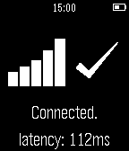

<!-- Generated by scripts/update_app_directory.py: do not edit by hand -->
[← All Pebble Developers](../developers.md)

# empayne

*1 app · Last updated 2026-10-11 · [About these lists](../about-app-lists.md)*

Links: [Pebble App Store](https://apps.repebble.com/apps/dev/empayne_5479fc7e0723085390000059) · [GitHub (empayne)](https://github.com/empayne)

<h2 class="app-name" id="app-54a83e3fdf4908bb310000b4"><a href="https://apps.repebble.com/54a83e3fdf4908bb310000b4">Pingly</a> v1.0</h2>
<a class="app-source" href="https://github.com/empayne/pingly" title="Source code" data-search-exclude>View source</a>

App

Released 2015-01-03 Updated 2015-01-03

Runs on: Time 2, Pebble 2 Duo, Pebble 2, Time, Classic

Instantly check if you&#x27;re connected to the Internet from your Pebble! Pingly pings Google and tells you if you&#x27;re connected to or disconnected from the Internet. It provides latency data to tell…

