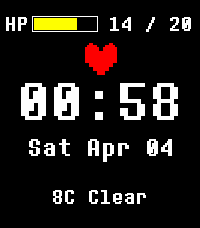

<!-- Generated by scripts/update_app_directory.py: do not edit by hand -->
[← All Pebble Developers](../developers.md)

# engineerrunner

*1 watchface · Last updated 2026-10-12 · [About these lists](../about-app-lists.md)*

Links: [Pebble App Store](https://apps.repebble.com/apps/dev/engineerrunner_69b5bb41cdba1c0008bafe36) · [GitHub (EngineerRunner)](https://github.com/EngineerRunner)

<h2 class="app-name" id="app-95bbad18b5df477a9b970702"><a href="https://apps.repebble.com/95bbad18b5df477a9b970702">underface</a> v1.1</h2>
<a class="app-source" href="https://github.com/EngineerRunner/underface" title="Source code" data-search-exclude>View source</a>

Watchface

GPL-3.0 Released 2026-04-04 Updated 2026-04-04

Runs on: Round 2, Time 2

a watchface built with Alloy, inspired by undertale. features: - 7 soul colours, one for each day of the week - date and time - weather - battery (health bar)

