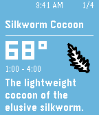
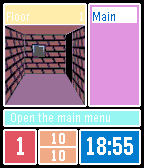
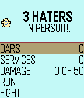

<!-- Generated by scripts/update_app_directory.py: do not edit by hand -->
[← All Pebble Developers](../developers.md)

# Enova

*3 apps · Last updated 2026-10-11 · [About these lists](../about-app-lists.md)*

Links: [Rebble App Store](https://apps.rebble.io/en_US/developer/55f606cf883da5793f000019/1) · [Pebble App Store](https://apps.repebble.com/apps/dev/elijahzawesome_55f606cf883da5793f000019) · [GitHub (Enovale)](https://github.com/Enovale) · [GitHub (Torivon)](https://github.com/Torivon) · [GitHub (ElijahZAwesome)](https://github.com/ElijahZAwesome)

<button type="button" data-filter="all" aria-pressed="true">All 3</button><button type="button" data-filter="watchface" aria-pressed="false" disabled>Watchfaces 0</button><button type="button" data-filter="watchapp" aria-pressed="false">Apps 3</button>

<label class="dev-sort">Sort by <select><option value="updated">Recently updated</option><option value="released">Newest release</option><option value="title">A–Z</option></select></label>

<h2 class="app-name" id="app-6605dfa3ea09ac08481d6b6a"><a href="https://apps.rebble.io/en_US/application/6605dfa3ea09ac08481d6b6a">Eorzian Events</a> v0.1</h2>
<a class="app-source" href="https://github.com/Enovale/eorzian-events" title="Source code" data-search-exclude>View source</a>

App

MIT Released 2024-03-28 Updated 2024-03-28 Rebble App Store

Runs on: Round 2, Time 2, Pebble 2 Duo, Pebble 2, Time Round, Time, Classic

Displays information and notifies you of timed items/locations in Final Fantasy XIV.

<h2 class="app-name" id="app-5800314d2cde6585e50002a4"><a href="https://apps.rebble.io/en_US/application/5800314d2cde6585e50002a4">DungeonTale</a> v4.5</h2>
<a class="app-source" href="https://github.com/Torivon/MiniDungeon" title="Source code" data-search-exclude>View source</a>

App

MIT Released 2016-10-14 Updated 2016-10-30 Rebble App Store

Runs on: Round 2, Time 2, Pebble 2 Duo, Pebble 2, Time Round, Time, Classic

DISCLAIMER: This is a fork of MiniDungeon https://github.com/Torivon/MiniDungeon and was made a long time ago when I was quite young. Here be dragons. This is a game of traversing through a…

<h2 class="app-name" id="app-580ad207e1956855d1000075"><a href="https://apps.repebble.com/580ad207e1956855d1000075">Meme Wars</a> v3.5</h2>
<a class="app-source" href="https://github.com/ElijahZAwesome/MemeWars" title="Source code" data-search-exclude>View source</a>

App

No licence Released 2016-10-22 Updated 2016-10-22

Runs on: Time 2, Pebble 2 Duo, Pebble 2, Time, Classic

This is a sort of &quot;hack&quot; of Drug Wars for pebble. ABSOLUTELY ALL CREDIT GOES TO ACLYMER HE CREATED THIS GAME. IM JUST TRYING TO HAVE SOME FUN WITH IT. Your job is to sell and buy memes so that you…

