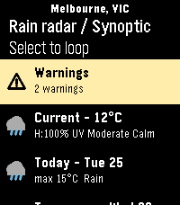
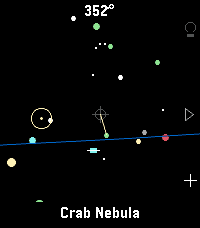

<!-- Generated by scripts/update_app_directory.py: do not edit by hand -->
[← All Pebble Developers](../developers.md)

# erad84

*3 apps · Last updated 2026-10-12 · [About these lists](../about-app-lists.md)*

Links: [Pebble App Store](https://apps.repebble.com/apps/dev/erad84_82bfdc4637e455ac2605841f) · [GitHub (erad84)](https://github.com/erad84)

<button type="button" data-filter="all" aria-pressed="true">All 3</button><button type="button" data-filter="watchface" aria-pressed="false" disabled>Watchfaces 0</button><button type="button" data-filter="watchapp" aria-pressed="false">Apps 3</button>

<label class="dev-sort">Sort by <select><option value="updated">Recently updated</option><option value="released">Newest release</option><option value="title">A–Z</option></select></label>

<h2 class="app-name" id="app-512528cffc5f49ccabd99686"><a href="https://apps.repebble.com/512528cffc5f49ccabd99686">NRL Fan</a> v1.0.3</h2>
<a class="app-source" href="https://github.com/erad84/NRL-fan" title="Source code" data-search-exclude>View source</a>

App

No licence Released 2026-08-24 Updated 2026-09-23

Runs on: Round 2, Time 2, Pebble 2 Duo, Pebble 2, Time Round, Time, Classic

An app for Australian NRL fans to keep up with their favourite teams. It features: - Set your favourite team and code (NRL, NRLW + Origin series) - Current ladder and rankings - Upcoming matches…

<h2 class="app-name" id="app-3c15e779928d45008d602236"><a href="https://apps.repebble.com/3c15e779928d45008d602236">BOM Weather</a> v1.1.2</h2>
<a class="app-source" href="https://github.com/erad84/BOM-Weather" title="Source code" data-search-exclude>View source</a>

App

No licence Released 2026-08-24 Updated 2026-08-30

Runs on: Round 2, Time 2, Pebble 2 Duo, Pebble 2, Time Round, Time, Classic

An app for the Australian Bureau of Meteorology (BOM) weather service. Features: - Set or auto-detect your town for weather specific to you - Looping Rain Radar with various distance views (use…

<h2 class="app-name" id="app-e69d5a2df1fa4e54a8e24cc6"><a href="https://apps.repebble.com/e69d5a2df1fa4e54a8e24cc6">Star Watch</a> v1.1.0</h2>
<a class="app-source" href="https://github.com/erad84/star-watch" title="Source code" data-search-exclude>View source</a>

App

No licence Released 2026-08-24 Updated 2026-08-25

Runs on: Round 2, Time 2, Pebble 2 Duo

A tool for finding and identifying objects in the night sky. Just hold your wrist up to the sky and discover what&#x27;s up there! Features include: - Manual targeting (point the crosshair at sky…

