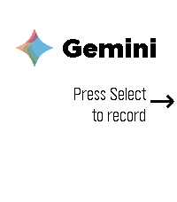
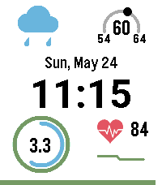
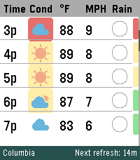
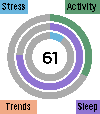
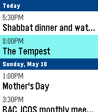

<!-- Generated by scripts/update_app_directory.py: do not edit by hand -->
[← All Pebble Developers](../developers.md)

# Eric McCormick

*1 watchface and 4 apps · Last updated 2026-10-11 · [About these lists](../about-app-lists.md)*

Links: [Pebble App Store](https://apps.repebble.com/apps/dev/eric-mccormick_7c70eafc41fc666a529a8f07) · [GitHub (ericlmccormick)](https://github.com/ericlmccormick) · [Website (ko-fi.com)](https://ko-fi.com/ericmccormick)

<button type="button" data-filter="all" aria-pressed="true">All 5</button><button type="button" data-filter="watchface" aria-pressed="false">Watchfaces 1</button><button type="button" data-filter="watchapp" aria-pressed="false">Apps 4</button>

<label class="dev-sort">Sort by <select><option value="updated">Recently updated</option><option value="released">Newest release</option><option value="title">A–Z</option></select></label>

<h2 class="app-name" id="app-cc4b971bf63c427d8870e526"><a href="https://apps.repebble.com/cc4b971bf63c427d8870e526">Gemini Voice &amp; Text</a> v1.4.4</h2>
<a class="app-source" href="https://github.com/ericlmccormick/Pebble_Gemini" title="Source code" data-search-exclude>View source</a>

App

Released 2026-05-22 Updated 2026-08-22

Runs on: Round 2, Time 2, Pebble 2 Duo, Pebble 2, Time Round, Time

This app turns your Pebble Time 2 into a fully functional conversational assistant using Google&#x27;s Gemini with model and voice selection. If you enjoy what I am making don&#x27;t forget to heart the…

<h2 class="app-name" id="app-7f9c89453f7548e1ac494236"><a href="https://apps.repebble.com/7f9c89453f7548e1ac494236">KinetiCast</a> v2.2.1</h2>
<a class="app-source" href="https://github.com/ericlmccormick/Pebble_Health_and_Weather" title="Source code" data-search-exclude>View source</a>

Watchface

Released 2026-05-05 Updated 2026-07-31

Runs on: Time 2

Current weather on top (high/low temp, current condition, current temp), date and time in the middle, health data(heart rate, steps, calories) on the bottom

<h2 class="app-name" id="app-1149e6999c21493aa99532e7"><a href="https://apps.repebble.com/1149e6999c21493aa99532e7">Timeline WX</a> v2.3.1</h2>
<a class="app-source" href="https://github.com/ericlmccormick/Pebble_Hourly_Weather/" title="Source code" data-search-exclude>View source</a>

App

Released 2026-05-05 Updated 2026-07-28

Runs on: Time 2

Pulls the next 24hrs of weather at your location. Shows temperature, conditions(icon), wind speed, chance of rain(pie chart) and UV (color bar). Text colors change based on severity. Displays 6hrs…

<h2 class="app-name" id="app-11c122085392419b8479ce94"><a href="https://apps.repebble.com/11c122085392419b8479ce94">VitalGauge</a> v2.3.1</h2>
<a class="app-source" href="https://github.com/ericlmccormick/Pebble_Stress_Tracker" title="Source code" data-search-exclude>View source</a>

App

Released 2026-05-17 Updated 2026-07-27

Runs on: Time 2

Main screen provides a history of hear rate Pressing up takes you to a screen for measuring your heart rate and stress level. EKG simulator using your actual BPM. Scrolling down take you to box…

<h2 class="app-name" id="app-82451ba23ca641ab82821fa6"><a href="https://apps.repebble.com/82451ba23ca641ab82821fa6">7day ICS Calendar</a> v1.4.1</h2>
<a class="app-source" href="https://github.com/ericlmccormick/Pebble_7_day_ICS_Calendar" title="Source code" data-search-exclude>View source</a>

App

Released 2026-05-08 Updated 2026-07-02

Runs on: Round 2, Time 2, Pebble 2 Duo, Pebble 2, Time Round, Time, Classic

This is designed to pull the date time and name of the events happening in the next 7 days from any ICS file. I have only tested it using a private google calendar but should work with any.

