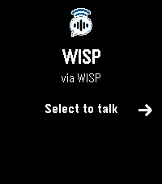
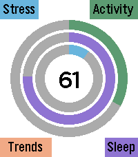
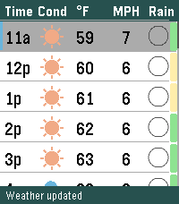
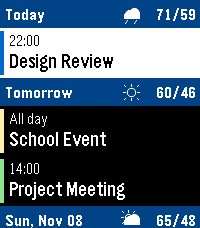
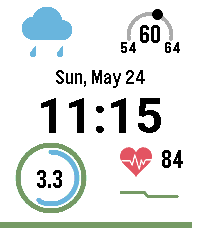
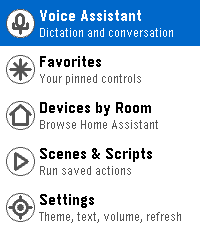
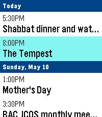

<!-- Generated by scripts/update_app_directory.py: do not edit by hand -->
[← All Pebble Developers](../developers.md)

# Eric McCormick

*1 watchface and 6 apps · Last updated 2026-11-23 · [About these lists](../about-app-lists.md)*

Links: [Pebble App Store](https://apps.repebble.com/apps/dev/eric-mccormick_7c70eafc41fc666a529a8f07) · [GitHub (ericlmccormick)](https://github.com/ericlmccormick) · [Website (ko-fi.com)](https://ko-fi.com/ericmccormick)

<button type="button" data-filter="all" aria-pressed="true">All 7</button><button type="button" data-filter="watchface" aria-pressed="false">Watchfaces 1</button><button type="button" data-filter="watchapp" aria-pressed="false">Apps 6</button>

<label class="dev-sort">Sort by <select><option value="updated">Recently updated</option><option value="released">Newest release</option><option value="title">A–Z</option></select></label>

<h2 class="app-name" id="app-cc4b971bf63c427d8870e526"><a href="https://apps.repebble.com/cc4b971bf63c427d8870e526">WISP -Wrist Intelligence &amp; Speech Portal</a> v2.3.0</h2>
<a class="app-source" href="https://github.com/ericlmccormick/Pebble-WISP" title="Source code" data-search-exclude>View source</a>

App

No licence Released 2026-05-22 Updated 2026-11-22

Runs on: Round 2, Time 2, Pebble 2 Duo, Pebble 2, Time Round, Time

Your AI assistant. Your voice. Your Pebble. Long voice replies are easier to read on Pebble Round 2, and the app recovers from stalled voice requests. If you use Direct Gemini, you can test the…

<h2 class="app-name" id="app-11c122085392419b8479ce94"><a href="https://apps.repebble.com/11c122085392419b8479ce94">VitalGauge</a> v2.6.0</h2>
<a class="app-source" href="https://github.com/ericlmccormick/Pebble-VitalGauge" title="Source code" data-search-exclude>View source</a>

App

No licence Released 2026-05-17 Updated 2026-11-22

Runs on: Time 2

VitalGauge — Your Body&#x27;s Dashboard for Pebble Time 2 Use touch or the Up, Down, and Select buttons to open dashboard cards. Stress scans skip an estimate if the heart-rate samples are too sparse…

<h2 class="app-name" id="app-1149e6999c21493aa99532e7"><a href="https://apps.repebble.com/1149e6999c21493aa99532e7">Timeline WX</a> v2.7.0</h2>
<a class="app-source" href="https://github.com/ericlmccormick/Pebble-Timeline-WX" title="Source code" data-search-exclude>View source</a>

App

No licence Released 2026-05-05 Updated 2026-11-22

Runs on: Time 2

Your next 48 hours, visualized. Built specifically to push the limits of the Pebble Time 2&#x27;s high-resolution display. Whether you&#x27;re coordinating a Scout campout, dialing in your morning commute…

<h2 class="app-name" id="app-da9ef484253f4ee780a808f6"><a href="https://apps.repebble.com/da9ef484253f4ee780a808f6">Next Up Agenda</a> v1.3.0</h2>
<a class="app-source" href="https://github.com/ericlmccormick/Next-Up-Agenda" title="Source code" data-search-exclude>View source</a>

App

No licence Released 2026-11-06 Updated 2026-11-22

Runs on: Round 2, Time 2, Pebble 2 Duo, Pebble 2, Time Round, Time, Classic

Your upcoming calendar events and daily weather, all in one place. Event lists and details fit round Pebble screens. Narrow displays keep dates and daily high and low temperatures readable…

<h2 class="app-name" id="app-7f9c89453f7548e1ac494236"><a href="https://apps.repebble.com/7f9c89453f7548e1ac494236">KinetiCast</a> v2.6.0</h2>
<a class="app-source" href="https://github.com/ericlmccormick/Pebble-KinetiCast" title="Source code" data-search-exclude>View source</a>

Watchface

No licence Released 2026-05-05 Updated 2026-11-22

Runs on: Time 2

A smarter Pebble watchface that brings together your health, weather, and everyday information in one customizable display. The next-event panel makes room for longer titles above the countdown…

<h2 class="app-name" id="app-530052d2d2454cae8ca8db79"><a href="https://apps.repebble.com/530052d2d2454cae8ca8db79">Home Assistant Control Center</a> v2.2.0</h2>
<a class="app-source" href="https://github.com/ericlmccormick/Pebble-Home-Assistant-AI" title="Source code" data-search-exclude>View source</a>

App

No licence Released 2026-11-03 Updated 2026-11-22

Runs on: Round 2, Time 2, Pebble 2 Duo, Pebble 2, Time Round, Time

Control your Home Assistant devices and talk to your Assist agent from your Pebble. Home Assistant Control Center was previously called Home Assistant AI. Device readings, controls, and voice…

<h2 class="app-name" id="app-82451ba23ca641ab82821fa6"><a href="https://apps.repebble.com/82451ba23ca641ab82821fa6">7day ICS Calendar</a> v1.10.0</h2>
<a class="app-source" href="https://github.com/ericlmccormick/Pebble_7_day_ICS_Calendar" title="Source code" data-search-exclude>View source</a>

App

No licence Released 2026-05-08 Updated 2026-11-22

Runs on: Round 2, Time 2, Pebble 2 Duo, Pebble 2, Time Round, Time, Classic

Leave your phone in your pocket. 7-Day ICS Calendar brings your Google Calendar(any ICS should work) directly to your wrist, beautifully organized and always available—even when you&#x27;re offline…

