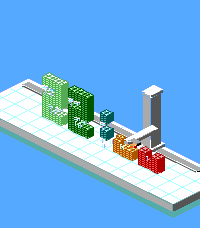
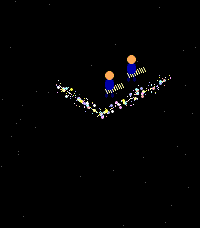
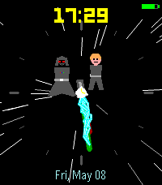
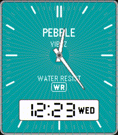
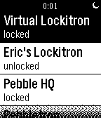

<!-- Generated by scripts/update_app_directory.py: do not edit by hand -->
[← All Pebble Developers](../developers.md)

# Eric Migicovsky

*4 watchfaces and 1 app · Last updated 2026-10-12 · [About these lists](../about-app-lists.md)*

Links: [Pebble App Store](https://apps.repebble.com/apps/dev/eric-migicovsky_cef3527f00d692f8c467ca17) · [GitHub (ericmigi)](https://github.com/ericmigi)

<button type="button" data-filter="all" aria-pressed="true">All 5</button><button type="button" data-filter="watchface" aria-pressed="false">Watchfaces 4</button><button type="button" data-filter="watchapp" aria-pressed="false">Apps 1</button>

<label class="dev-sort">Sort by <select><option value="updated">Recently updated</option><option value="released">Newest release</option><option value="title">A–Z</option></select></label>

<h2 class="app-name" id="app-40a625e429a74c9c87df0150"><a href="https://apps.repebble.com/40a625e429a74c9c87df0150">3D Printer</a> v1.0.1</h2>
<a class="app-source" href="https://github.com/ericmigi/iso-printer" title="Source code" data-search-exclude>View source</a>

Watchface

No licence Released 2026-08-24 Updated 2026-08-24

Runs on: Round 2, Time 2

My son is obsessed with 3d printing and came up with the idea for this watchface! One other cool thing - it uses your current location and time of year to accurately paint shadows.

<h2 class="app-name" id="app-1daacb77279040179e08d435"><a href="https://apps.repebble.com/1daacb77279040179e08d435">Swept Away</a> v1.0.0</h2>
<a class="app-source" href="https://github.com/ericmigi/sweptaway" title="Source code" data-search-exclude>View source</a>

Watchface

No licence Released 2026-06-30 Updated 2026-06-30

Runs on: Round 2, Time 2

A Pebble watchface inspired by Dutch artist Maarten Baas&#x27; Sweepers Clock (from his Real Time series), in which two street sweepers spend twelve hours pushing piles of rubbish into the shape of an…

<h2 class="app-name" id="app-ed8f618edf134fa09f356a30"><a href="https://apps.repebble.com/ed8f618edf134fa09f356a30">Duel Of The Faces</a> v1.0.1</h2>
<a class="app-source" href="https://github.com/ericmigi/lightsaber-duel" title="Source code" data-search-exclude>View source</a>

Watchface

No licence Released 2026-05-08 Updated 2026-05-08

Runs on: Round 2, Time 2, Pebble 2 Duo

A Star Wars-inspired watch face. Luke and Darth Vader &#x27;face&#x27; o quote face off every minute or hour, depending on the configured setting. Sound effects match the animation but are not played during…

<h2 class="app-name" id="app-f8ea4d34aa3d4ba594745fac"><a href="https://apps.repebble.com/f8ea4d34aa3d4ba594745fac">Ana-digi Vibez</a> v1.0.0</h2>
<a class="app-source" href="https://github.com/ericmigi/anadigi-vibez" title="Source code" data-search-exclude>View source</a>

Watchface

No licence Released 2026-03-26 Updated 2026-03-26

Runs on: Round 2, Time 2

Retro ana-digi with Casio vibes! For Pebble Time 2 and Pebble Round 2

<h2 class="app-name" id="app-5394ad79e553f6ec0a000094"><a href="https://apps.repebble.com/5394ad79e553f6ec0a000094">Pebbletron</a> v1.1</h2>
<a class="app-source" href="https://github.com/ericmigi/PebbleTron" title="Source code" data-search-exclude>View source</a>

App

No licence Released 2014-06-08 Updated 2014-06-09

Runs on: Time 2, Pebble 2 Duo, Pebble 2, Time, Classic

Control your Lockitron lock right from your Pebble! Built using Pebble.js and Cloudpebble.net. Thanks Huy and Katharine! No locks? remember to log in: My Pebble -&gt; Pebbletron -&gt; Settings Source…

