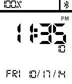

<!-- Generated by scripts/update_app_directory.py: do not edit by hand -->
[← All Pebble Developers](../developers.md)

# Eric Sauer

*1 watchface · Last updated 2026-10-12 · [About these lists](../about-app-lists.md)*

Links: [Pebble App Store](https://apps.repebble.com/apps/dev/eric-sauer_532b8853ab060abd7d000044) · [GitHub (ericmsauer)](https://github.com/ericmsauer) · [Website (ericsauer.com)](http://ericsauer.com/)

<h2 class="app-name" id="app-538e4d5147d103075a00001f"><a href="https://apps.repebble.com/538e4d5147d103075a00001f">Simplicity</a> v1.3</h2>
<a class="app-source" href="https://github.com/ericmsauer/pebble_simplicity" title="Source code" data-search-exclude>View source</a>

Watchface

No licence Released 2014-06-03 Updated 2015-02-02

Runs on: Time 2, Pebble 2 Duo, Pebble 2, Time, Classic

This is a watch face that keeps the information you need simple and readable. It displays: - Battery Level/Status (Charging/Discharging) - Bluetooth Connection (On/Off) - Time…

