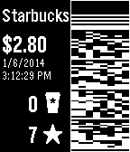

<!-- Generated by scripts/update_app_directory.py: do not edit by hand -->
[← All Pebble Developers](../developers.md)

# Eric Wood

*1 app · Last updated 2026-10-12 · [About these lists](../about-app-lists.md)*

Links: [Pebble App Store](https://apps.repebble.com/apps/dev/eric-wood_52f17df0f216769cb900040a) · [GitHub (esw148)](https://github.com/esw148)

<h2 class="app-name" id="app-53820c69ad57fd7a430000c9"><a href="https://apps.repebble.com/53820c69ad57fd7a430000c9">PebbleBucksE</a> v1.0.1</h2>
<a class="app-source" href="https://github.com/esw148/PebbleBucks" title="Source code" data-search-exclude>View source</a>

App

Other Released 2014-05-25 Updated 2014-05-25

Runs on: Time 2, Pebble 2 Duo, Pebble 2, Time, Classic

This lets you pay for Starbucks using your watch. You can also view your balance and rewards information. (This is based on the 2.0.1 version of the PebbleBucks app by Alexsander Akers. His 3.0…

