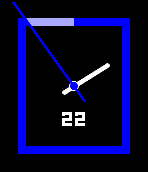

<!-- Generated by scripts/update_app_directory.py: do not edit by hand -->
[← All Pebble Developers](../developers.md)

# Erik Brinkman

*1 watchface · Last updated 2026-10-12 · [About these lists](../about-app-lists.md)*

Links: [Pebble App Store](https://apps.repebble.com/apps/dev/erik-brinkman_531a5f395af660a8c90009e9) · [GitHub (erikbrinkman)](https://github.com/erikbrinkman)

<h2 class="app-name" id="app-57bb39b7bb85edbc76000ac8"><a href="https://apps.repebble.com/57bb39b7bb85edbc76000ac8">Modernesque</a> v1.1</h2>
<a class="app-source" href="https://github.com/erikbrinkman/modernesque" title="Source code" data-search-exclude>View source</a>

Watchface

GPL-3.0 Released 2016-08-22 Updated 2016-09-03

Runs on: Round 2, Time 2, Pebble 2 Duo, Pebble 2, Time Round, Time, Classic

A simple modern watch face heavily inspired by &quot;Modern Classic 2&quot;.

