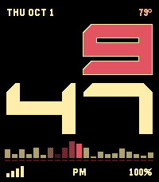

<!-- Generated by scripts/update_app_directory.py: do not edit by hand -->
[← All Pebble Developers](../developers.md)

# Erik Chevalier

*1 watchface · Last updated 2026-10-11 · [About these lists](../about-app-lists.md)*

Links: [Pebble App Store](https://apps.repebble.com/apps/dev/erik-chevalier_a35d2d43d45b920efe05ec14) · [GitHub (kaineone)](https://github.com/kaineone) · [Website (kaine.one)](https://www.kaine.one)

<h2 class="app-name" id="app-7beca89f985f493dbccbd9bd"><a href="https://apps.repebble.com/7beca89f985f493dbccbd9bd">Entity</a> v26.2</h2>
<a class="app-source" href="https://github.com/kaineone/entity-watchface" title="Source code" data-search-exclude>View source</a>

Watchface

Released 2026-10-02 Updated 2026-10-03

Runs on: Round 2, Time 2, Pebble 2 Duo, Time Round, Time

Entity is online. A simple, minimal watchface: the time in big block numbers, with a red scanner along the bottom, or around the edge on round watches. Totally free. No premium version, no…

