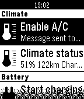

<!-- Generated by scripts/update_app_directory.py: do not edit by hand -->
[← All Pebble Developers](../developers.md)

# Erik de Bruijn

*1 app · Last updated 2026-10-11 · [About these lists](../about-app-lists.md)*

Links: [Pebble App Store](https://apps.repebble.com/apps/dev/erik-de-bruijn_52f005973fbdba4ebc000018) · [GitHub (ErikDeBruijn)](https://github.com/ErikDeBruijn) · [Website (erikdebruijn.nl)](http://www.erikdebruijn.nl/)

<h2 class="app-name" id="app-5300fe0261dee5ed4a00014a"><a href="https://apps.repebble.com/5300fe0261dee5ed4a00014a">Tesla Control</a> v2.5</h2>
<a class="app-source" href="https://github.com/ErikDeBruijn/TeslaFTW" title="Source code" data-search-exclude>View source</a>

App

GPL-3.0 Released 2014-02-16 Updated 2016-10-22

Runs on: Round 2, Time 2, Pebble 2 Duo, Pebble 2, Time Round, Time, Classic

Control your Tesla Model S or X. Start/stop charging, heat/cool your car, you can check in/outdoor temperatures, see your range... Enter Tesla login on the phone through &quot;Settings&quot;. Initially the…

