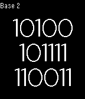

<!-- Generated by scripts/update_app_directory.py: do not edit by hand -->
[← All Pebble Developers](../developers.md)

# Evan Bernstein

*1 app · Last updated 2026-10-11 · [About these lists](../about-app-lists.md)*

Links: [Pebble App Store](https://apps.repebble.com/apps/dev/evan-bernstein_52f017d38e6ca0e8f2000219) · [GitHub (eeevanbbb)](https://github.com/eeevanbbb)

<h2 class="app-name" id="app-531696cc9497a69aa90002cc"><a href="https://apps.repebble.com/531696cc9497a69aa90002cc">Multibase Clock</a> v1.0</h2>
<a class="app-source" href="https://github.com/eeevanbbb/MultiBaseClock" title="Source code" data-search-exclude>View source</a>

App

Released 2014-03-05 Updated 2014-03-05

Runs on: Time 2, Pebble 2 Duo, Pebble 2, Time, Classic

Multibase Clock displays time in bases 2-16. Switch bases with the up and down buttons. Click the center button to see an analog version.

