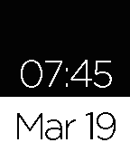

<!-- Generated by scripts/update_app_directory.py: do not edit by hand -->
[← All Pebble Developers](../developers.md)

# Evan DeVrieze

*1 watchface · Last updated 2026-10-11 · [About these lists](../about-app-lists.md)*

Links: [Pebble App Store](https://apps.repebble.com/apps/dev/evan-devrieze_536e45d78b248a38be00016e) · [GitHub (devrevan)](https://github.com/devrevan)

<h2 class="app-name" id="app-550abeed84ad02c80c000119"><a href="https://apps.repebble.com/550abeed84ad02c80c000119">Simple Watchface</a> v1.1</h2>
<a class="app-source" href="https://github.com/devrevan/simplePebbleWatchFace" title="Source code" data-search-exclude>View source</a>

Watchface

Released 2015-03-19 Updated 2015-03-19

Runs on: Time 2, Pebble 2 Duo, Pebble 2, Time, Classic

An extremely simple watchface that I like to use myself. Second screenshot shows accurate colors for when it&#x27;s on the watch.

