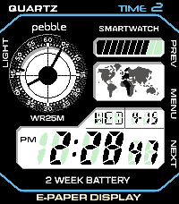

<!-- Generated by scripts/update_app_directory.py: do not edit by hand -->
[← All Pebble Developers](../developers.md)

# Evie Finch

*1 watchface · Last updated 2026-10-12 · [About these lists](../about-app-lists.md)*

Links: [Pebble App Store](https://apps.repebble.com/apps/dev/evie-finch_9d5d9f7fccc8a26da37fdbd6) · [GitHub (qt-dork)](https://github.com/qt-dork)

<h2 class="app-name" id="app-ae80da4fd2d54efc9e907b11"><a href="https://apps.repebble.com/ae80da4fd2d54efc9e907b11">Royale</a> v2.2.0</h2>
<a class="app-source" href="https://github.com/qt-dork/zig-pebble-face" title="Source code" data-search-exclude>View source</a>

Watchface · <a href="https://forum.rebble.io/t/881" title="Discuss this app on the Rebble forum" data-search-exclude>Forum thread</a>

Released 2026-04-15 Updated 2026-10-11

Runs on: Time 2

Finally, a watch for the 80s! Royale is a watchface emulating the look of the Casio AE-1200 built with the Pebble Time 2 in mind, with support for other Pebbles coming soon. It features beautiful…

