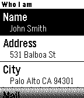

<!-- Generated by scripts/update_app_directory.py: do not edit by hand -->
[← All Pebble Developers](../developers.md)

# expositomarc

*1 app · Last updated 2026-10-12 · [About these lists](../about-app-lists.md)*

Links: [Rebble App Store](https://apps.rebble.io/en_US/developer/53974c92cc86541d68000065/1) · [GitHub (expositomarc)](https://github.com/expositomarc) · [Website (marcexposito.com)](http://www.marcexposito.com/portfolio/who-i-am-for-pebble/)

<h2 class="app-name" id="app-53e53cfad9e891f46e000179"><a href="https://apps.rebble.io/en_US/application/53e53cfad9e891f46e000179">Who I am for Pebble</a> v1.0</h2>
<a class="app-source" href="https://github.com/expositomarc/Who-I-am-for-Pebble" title="Source code" data-search-exclude>View source</a>

App

No licence Released 2014-08-08 Updated 2014-08-30 Rebble App Store

Runs on: Time 2, Pebble 2 Duo, Pebble 2, Time, Classic

Identify your Pebble as it was your ID. Fill out all the fields using the iOS app and press synchronize to send your info to your Pebble. Don&#x27;t be afraid of losing your Pebble anymore!

