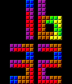
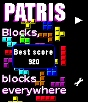

<!-- Generated by scripts/update_app_directory.py: do not edit by hand -->
[← All Pebble Developers](../developers.md)

# Fabien

*1 watchface and 1 app · Last updated 2026-10-11 · [About these lists](../about-app-lists.md)*

Links: [Pebble App Store](https://apps.repebble.com/apps/dev/fabien_5504bcb38d390726a800002d) · [GitHub (Fabien-Chouteau)](https://github.com/Fabien-Chouteau)

<button type="button" data-filter="all" aria-pressed="true">All 2</button><button type="button" data-filter="watchface" aria-pressed="false">Watchfaces 1</button><button type="button" data-filter="watchapp" aria-pressed="false">Apps 1</button>

<label class="dev-sort">Sort by <select><option value="updated">Recently updated</option><option value="released">Newest release</option><option value="title">A–Z</option></select></label>

<h2 class="app-name" id="app-561a73451a1d8994a700007e"><a href="https://apps.repebble.com/561a73451a1d8994a700007e">Patris Watch</a> v1.1</h2>
<a class="app-source" href="https://github.com/Fabien-Chouteau/Ada_Time" title="Source code" data-search-exclude>View source</a>

Watchface

No licence Released 2015-10-11 Updated 2015-11-04

Runs on: Time 2, Time

Falling blocks telling you what time is it. See more at http://blog.adacore.com/make-with-ada-formal-proof-on-my-wrist

<h2 class="app-name" id="app-559af16358bc81d930000067"><a href="https://apps.repebble.com/559af16358bc81d930000067">Patris</a> v1.2</h2>
<a class="app-source" href="https://github.com/Fabien-Chouteau/Ada_Time" title="Source code" data-search-exclude>View source</a>

App

No licence Released 2015-07-06 Updated 2015-11-04

Runs on: Time 2, Time

Patris is a game inspired by the famous classic falling blocks. The game is automatically saved when you exit the app and you can change level in the menu. This app was developed using formal…

