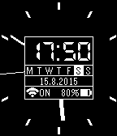

<!-- Generated by scripts/update_app_directory.py: do not edit by hand -->
[← All Pebble Developers](../developers.md)

# Fabsch &amp; High-to-Light

*1 watchface · Last updated 2026-10-11 · [About these lists](../about-app-lists.md)*

Links: [Pebble App Store](https://apps.repebble.com/apps/dev/fabsch-high-to-light_550c28a486a646686f000084) · [GitHub (Fabsch)](https://github.com/Fabsch)

<h2 class="app-name" id="app-55cf562eba79f56bdc00002a"><a href="https://apps.repebble.com/55cf562eba79f56bdc00002a">Twace</a> v1.6.0</h2>
<a class="app-source" href="https://github.com/Fabsch/twace" title="Source code" data-search-exclude>View source</a>

Watchface

GPL-3.0 Released 2015-08-15 Updated 2026-10-06

Runs on: Round 2, Time 2, Pebble 2 Duo, Pebble 2, Time Round, Time, Classic

Combined analogue and digital watchface with lots of information like the current date/weekday, battery/charging status and Bluetooth status.

