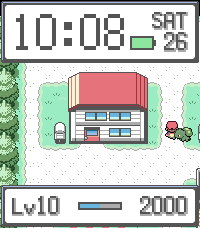

<!-- Generated by scripts/update_app_directory.py: do not edit by hand -->
[← All Pebble Developers](../developers.md)

# fccview labs

*1 watchface · Last updated 2026-10-11 · [About these lists](../about-app-lists.md)*

Links: [Rebble App Store](https://apps.rebble.io/en_US/developer/6ac3761fefcf57000870107c/1) · [GitHub (fccview)](https://github.com/fccview)

<h2 class="app-name" id="app-6ac37aa0b95ba2000991875a"><a href="https://apps.rebble.io/en_US/application/6ac37aa0b95ba2000991875a">Stepolution</a> v0.1.1</h2>
<a class="app-source" href="https://github.com/fccview/stepolution" title="Source code" data-search-exclude>View source</a>

Watchface · <a href="https://forum.rebble.io/t/1407" title="Discuss this app on the Rebble forum" data-search-exclude>Forum thread</a>

Released 2026-10-05 Updated 2026-10-05 Rebble App Store

Runs on: Time 2

A Pokemon watchface for the Pebble Time 2. Red or Leaf walks around a real FRLG map with a Pokemon that levels up as you walk, following one tile behind you.

