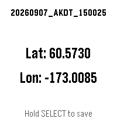

<!-- Generated by scripts/update_app_directory.py: do not edit by hand -->
[← All Pebble Developers](../developers.md)

# Fefe-Vernius

*1 app · Last updated 2026-10-11 · [About these lists](../about-app-lists.md)*

Links: [Pebble App Store](https://apps.repebble.com/apps/dev/fefe-vernius_10ca5708f03a2e5eb9458994) · [GitHub (Fefe-Vernius)](https://github.com/Fefe-Vernius)

<h2 class="app-name" id="app-d63277af0da045f98518baef"><a href="https://apps.repebble.com/d63277af0da045f98518baef">GPS Memo</a> v1.1.0</h2>
<a class="app-source" href="https://github.com/Fefe-Vernius/GPS-Memo" title="Source code" data-search-exclude>View source</a>

App

No licence Released 2026-09-07 Updated 2026-09-08

Runs on: Round 2, Time 2, Pebble 2 Duo, Pebble 2, Time Round, Time, Classic

Save a GPS coordinate with a timestamp, right from your wrist. GPS Memo shows your current latitude and longitude on screen — hold the SELECT button to log an entry with the exact time down to the…

