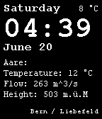

<!-- Generated by scripts/update_app_directory.py: do not edit by hand -->
[← All Pebble Developers](../developers.md)

# Felix

*1 watchface · Last updated 2026-10-11 · [About these lists](../about-app-lists.md)*

Links: [Pebble App Store](https://apps.repebble.com/apps/dev/felix_550d49d4783f36b3940000c1) · [GitHub (f3lan)](https://github.com/f3lan)

<h2 class="app-name" id="app-5584cb7f7726b7ecdc000071"><a href="https://apps.repebble.com/5584cb7f7726b7ecdc000071">Aare</a> v1.0</h2>
<a class="app-source" href="https://github.com/f3lan/aare-watchface/tree/master/aare" title="Source code" data-search-exclude>View source</a>

Watchface

Released 2015-06-20 Updated 2015-06-20

Runs on: Time 2, Pebble 2 Duo, Pebble 2, Time, Classic

This watchface displays the time, date and temperature but also the temperature, flow velocity and height of the Aare. Deutsch Dieses Watchface zeigt Zeit, Datum und Temperatur an und zusätzlich…

