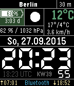
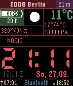

<!-- Generated by scripts/update_app_directory.py: do not edit by hand -->
[← All Pebble Developers](../developers.md)

# FG

*2 watchfaces and 2 apps · Last updated 2026-10-12 · [About these lists](../about-app-lists.md)*

Links: [Pebble App Store](https://apps.repebble.com/apps/dev/fg_53e39e90115605c0220000be) · [GitHub (cfg1)](https://github.com/cfg1)

<button type="button" data-filter="all" aria-pressed="true">All 4</button><button type="button" data-filter="watchface" aria-pressed="false">Watchfaces 2</button><button type="button" data-filter="watchapp" aria-pressed="false">Apps 2</button>

<label class="dev-sort">Sort by <select><option value="updated">Recently updated</option><option value="released">Newest release</option><option value="title">A–Z</option></select></label>

<h2 class="app-name" id="app-5569c2084bebd0b90400000e"><a href="https://apps.repebble.com/5569c2084bebd0b90400000e">Multifunctional 7 Segment</a> v16.1</h2>
<a class="app-source" href="https://github.com/cfg1/pebble-mss" title="Source code" data-search-exclude>View source</a>

Watchface · <a href="https://forum.rebble.io/t/1235" title="Discuss this app on the Rebble forum" data-search-exclude>Forum thread</a>

GPL-3.0 Released 2015-05-30 Updated 2026-08-15

Runs on: Round 2, Time 2, Pebble 2 Duo, Pebble 2, Time Round, Time, Classic

Seven Segment watchface which displays the follwing additional info: - time including seconds (sec. can be disabled or displayed on shaking) - weather (temperature/conditions/wind…

<h2 class="app-name" id="app-55d1f737718c7d376900000a"><a href="https://apps.repebble.com/55d1f737718c7d376900000a">Metar 7 Segment for Pilots</a> v2.5</h2>
<a class="app-source" href="https://github.com/cfg1/pebble-m7s-wf-metar" title="Source code" data-search-exclude>View source</a>

Watchface

No licence Released 2015-08-17 Updated 2016-10-08

Runs on: Round 2, Time 2, Pebble 2 Duo, Pebble 2, Time Round, Time, Classic

This watchface is a branch of Multifunctional 7 Segment which uses METAR weather data from AVWX and openweathermap.org simultanously. It is made mainly for day-to-day usage by pilots. The…

<h2 class="app-name" id="app-55cb4982ce49c23880000064"><a href="https://apps.repebble.com/55cb4982ce49c23880000064">Battery Logger</a> v1.1</h2>
<a class="app-source" href="https://github.com/cfg1/pebble-battery_logger" title="Source code" data-search-exclude>View source</a>

App

No licence Released 2015-08-12 Updated 2015-09-08

Runs on: Time 2, Pebble 2 Duo, Pebble 2, Time, Classic

App to measure and log battery runtime on the pebble without the phone.

<h2 class="app-name" id="app-557323107d6f3d5c37000067"><a href="https://apps.repebble.com/557323107d6f3d5c37000067">Bookmarks</a> v1.4</h2>
<a class="app-source" href="https://github.com/cfg1/pebble-bookmarks" title="Source code" data-search-exclude>View source</a>

App

GPL-3.0 Released 2015-06-06 Updated 2015-06-10

Runs on: Time 2, Pebble 2 Duo, Pebble 2, Time, Classic

Simple watchapp that can save your page numbers when reading books. No Bluetooth connection required. Book names can be edited.

