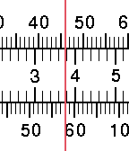
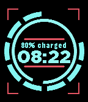
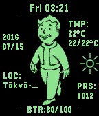
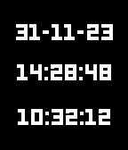
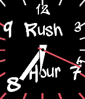
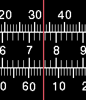

<!-- Generated by scripts/update_app_directory.py: do not edit by hand -->
[← All Pebble Developers](../developers.md)

# fieldWalking

*6 watchfaces · Last updated 2026-10-11 · [About these lists](../about-app-lists.md)*

Links: [Pebble App Store](https://apps.repebble.com/apps/dev/fieldwalking_52f88d452a8acf5cab00018f) · [Website (goo.gl)](http://goo.gl/DFYcFh)

<button type="button" data-filter="all" aria-pressed="true">All 6</button><button type="button" data-filter="watchface" aria-pressed="false">Watchfaces 6</button><button type="button" data-filter="watchapp" aria-pressed="false" disabled>Apps 0</button>

<label class="dev-sort">Sort by <select><option value="updated">Recently updated</option><option value="released">Newest release</option><option value="title">A–Z</option></select></label>

<h2 class="app-name" id="app-5835c69eca309421610000a7"><a href="https://apps.repebble.com/5835c69eca309421610000a7">Ruler white</a> v1.0</h2>
<a class="app-source" href="http://fieldwalking.jp/blog/watch-face_ruler/" title="Source code" data-search-exclude>View source</a>

Watchface

Released 2016-11-23 Updated 2016-11-23

Runs on: Round 2, Time 2, Time Round, Time

In order from the top minute,hour,second. If it&#x27;s ok with you,please try my app. Don&#x27;t step the White Tile. http://goo.gl/DFYcFh

<h2 class="app-name" id="app-5785910869ee718ea2000011"><a href="https://apps.repebble.com/5785910869ee718ea2000011">Battery Info</a> v1.3</h2>
<a class="app-source" href="http://fieldwalking.jp/blog/watch-face_battery-info/" title="Source code" data-search-exclude>View source</a>

Watchface

Released 2016-07-13 Updated 2016-11-23

Runs on: Round 2, Time 2, Time Round, Time

display clock and battery. inner circle means second. outer circle means remaining battery. If it&#x27;s ok with you,please try my app. Don&#x27;t step the White Tile. http://goo.gl/DFYcFh

<h2 class="app-name" id="app-57886f83ff7be078ab00028f"><a href="https://apps.repebble.com/57886f83ff7be078ab00028f">PiP-Boy</a> v1.3</h2>
<a class="app-source" href="http://fieldwalking.jp/blog/watch-face_pip-boy/" title="Source code" data-search-exclude>View source</a>

Watchface

Released 2016-07-15 Updated 2016-07-28

Runs on: Round 2, Time 2, Time Round, Time

Weather forecast with Pip-Boy! if the remaining the battery is less.animation speed slower rate. if location enable,weather is displayed in its place. else if input city id at setting,weather is…

<h2 class="app-name" id="app-5786fe5eff7be0c304000106"><a href="https://apps.repebble.com/5786fe5eff7be0c304000106">Expectancy</a> v1.0</h2>
<a class="app-source" href="http://fieldwalking.jp/blog/watch-face_expectancy/" title="Source code" data-search-exclude>View source</a>

Watchface

Released 2016-07-14 Updated 2016-07-14

Runs on: Round 2, Time 2, Time Round, Time

Lifetime calculation from setting and Display life expectancy. year:month:day hour:min:sec current time If it&#x27;s ok with you,please try my app. Don&#x27;t step the White Tile. http://goo.gl/DFYcFh

<h2 class="app-name" id="app-57836f4e66202aae400006cb"><a href="https://apps.repebble.com/57836f4e66202aae400006cb">Rush Hour</a> v1.1</h2>
<a class="app-source" href="http://fieldwalking.jp/blog/pebble-watchface_rushhour/" title="Source code" data-search-exclude>View source</a>

Watchface

Released 2016-07-11 Updated 2016-07-12

Runs on: Round 2, Time 2, Time Round, Time

Hurry ! Hurry to company. Clock hand will be quickly move between 7 to 9. If it&#x27;s ok with you,please try my app. Don&#x27;t step the White Tile. http://goo.gl/DFYcFh

<h2 class="app-name" id="app-5784cdc366202a9b8d0007f9"><a href="https://apps.repebble.com/5784cdc366202a9b8d0007f9">Ruler</a> v1.0</h2>
<a class="app-source" href="http://fieldwalking.jp/blog/watch-face_ruler/" title="Source code" data-search-exclude>View source</a>

Watchface

Released 2016-07-12 Updated 2016-07-12

Runs on: Round 2, Time 2, Time Round, Time

In order from the top minute,hour,second. If it&#x27;s ok with you,please try my app. Don&#x27;t step the White Tile. http://goo.gl/DFYcFh

