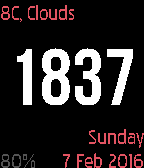
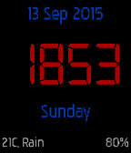

<!-- Generated by scripts/update_app_directory.py: do not edit by hand -->
[← All Pebble Developers](../developers.md)

# FiftySeven

*2 watchfaces · Last updated 2026-10-12 · [About these lists](../about-app-lists.md)*

Links: [Pebble App Store](https://apps.repebble.com/apps/dev/fiftyseven_539c19806efdf5e3370000eb) · [GitHub (MattChubb)](https://github.com/MattChubb)

<button type="button" data-filter="all" aria-pressed="true">All 2</button><button type="button" data-filter="watchface" aria-pressed="false">Watchfaces 2</button><button type="button" data-filter="watchapp" aria-pressed="false" disabled>Apps 0</button>

<label class="dev-sort">Sort by <select><option value="updated">Recently updated</option><option value="released">Newest release</option><option value="title">A–Z</option></select></label>

<h2 class="app-name" id="app-56b78f41d53a49bca200002a"><a href="https://apps.repebble.com/56b78f41d53a49bca200002a">Simple Red and White</a> v1.1</h2>
<a class="app-source" href="https://github.com/MattChubb/PebbleBasicWatchface/tree/redwhite" title="Source code" data-search-exclude>View source</a>

Watchface

No licence Released 2016-02-07 Updated 2016-02-07

Runs on: Time 2, Time

A simple red and white watchface. Weather, time, date are displayed diagonally, battery and bluetooth are placed at opposite corners. Different colour variants in the works, stay tuned!

<h2 class="app-name" id="app-55f5bd47c155b97503000098"><a href="https://apps.repebble.com/55f5bd47c155b97503000098">Simple Digital With Weather</a> v1.1</h2>
<a class="app-source" href="https://github.com/MattChubb/PebbleBasicWatchface" title="Source code" data-search-exclude>View source</a>

Watchface

No licence Released 2015-09-13 Updated 2015-10-25

Runs on: Time 2, Time

A basic digital watchface with weather+battery status.

