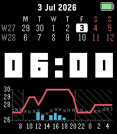

<!-- Generated by scripts/update_app_directory.py: do not edit by hand -->
[← All Pebble Developers](../developers.md)

# Filcuk

*1 watchface · Last updated 2026-10-12 · [About these lists](../about-app-lists.md)*

Links: [Pebble App Store](https://apps.repebble.com/apps/dev/filcuk_ca14dda8e44031072403fd6a) · [GitHub (filcuk)](https://github.com/filcuk)

<h2 class="app-name" id="app-d119efdfa11e498496d4d411"><a href="https://apps.repebble.com/d119efdfa11e498496d4d411">Argus</a> v1.3.1</h2>
<a class="app-source" href="https://github.com/filcuk/pebble-watchface-argus" title="Source code" data-search-exclude>View source</a>

Watchface · <a href="https://forum.rebble.io/t/1118" title="Discuss this app on the Rebble forum" data-search-exclude>Forum thread</a>

MIT Released 2026-07-04 Updated 2026-07-27

Runs on: Time 2

Argus guides you through the days ahead with hourly weather forecast, a two-week calendar view and a configurable header to focus on what is important.

