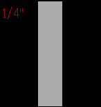

<!-- Generated by scripts/update_app_directory.py: do not edit by hand -->
[← All Pebble Developers](../developers.md)

# Filip

*1 app · Last updated 2026-10-12 · [About these lists](../about-app-lists.md)*

Links: [Pebble App Store](https://apps.repebble.com/apps/dev/filip_54edb7500cd3c5625500007b) · [GitHub (anderssonfilip)](https://github.com/anderssonfilip)

<h2 class="app-name" id="app-5666e0e39a52c999eb00001f"><a href="https://apps.repebble.com/5666e0e39a52c999eb00001f">Rope Size</a> v1.0</h2>
<a class="app-source" href="https://github.com/anderssonfilip/pebble-ropesize" title="Source code" data-search-exclude>View source</a>

App

No licence Released 2015-12-08 Updated 2015-12-08

Runs on: Time 2, Pebble 2 Duo, Pebble 2, Time, Classic

Utiltity for the Pebble watch to measure the dimension of a rope between 5/32&quot;(4mm) 1 1/32&quot; (26mm). Place part of the rope over the face of the watch to measure its width. Increase or decrease…

