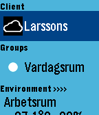

<!-- Generated by scripts/update_app_directory.py: do not edit by hand -->
[← All Pebble Developers](../developers.md)

# Fingalo

*2 apps · Last updated 2026-10-11 · [About these lists](../about-app-lists.md)*

Links: [Pebble App Store](https://apps.repebble.com/apps/dev/fingalo_538888906ef2f2762300012b) · [GitHub (fingalo)](https://github.com/fingalo)

<button type="button" data-filter="all" aria-pressed="true">All 2</button><button type="button" data-filter="watchface" aria-pressed="false" disabled>Watchfaces 0</button><button type="button" data-filter="watchapp" aria-pressed="false">Apps 2</button>

<label class="dev-sort">Sort by <select><option value="updated">Recently updated</option><option value="released">Newest release</option><option value="title">A–Z</option></select></label>

<h2 class="app-name" id="app-5400ffd65b56a15a20000003"><a href="https://apps.repebble.com/5400ffd65b56a15a20000003">NexaHome P</a> v2.1</h2>
<a class="app-source" href="https://github.com/fingalo/NexaHomeP" title="Source code" data-search-exclude>View source</a>

App

Released 2014-08-29 Updated 2016-11-18

Runs on: Round 2, Time 2, Pebble 2 Duo, Pebble 2, Time Round, Time, Classic

Pebble app for connecting to NexaHome (Tellstick) server. Control your ligths and wallsockets from you watch. Long press on middle button will cycle dimmers 25% at a time. See github for use of…

<h2 class="app-name" id="app-54307b17ec1644c4d2000007"><a href="https://apps.repebble.com/54307b17ec1644c4d2000007">LaTC Remote</a> v2.0</h2>
<a class="app-source" href="https://github.com/fingalo/LaTC-Remote.git" title="Source code" data-search-exclude>View source</a>

App

Released 2014-10-04 Updated 2016-01-04

Runs on: Round 2, Time 2, Pebble 2 Duo, Pebble 2, Time Round, Time, Classic

Pebble app for connecting to Telldus Live! server. Control your ligths and wallsockets from you watch. (Long press on middle button will cycle dimmers 25% at a time). Single press on sensor will…

