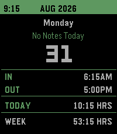

<!-- Generated by scripts/update_app_directory.py: do not edit by hand -->
[← All Pebble Developers](../developers.md)

# Firefreak9

*1 app · Last updated 2026-10-11 · [About these lists](../about-app-lists.md)*

Links: [Pebble App Store](https://apps.repebble.com/apps/dev/firefreak9_d4ca9c1ea40f3cef05627b1e) · [GitHub (firefreak9)](https://github.com/firefreak9)

<h2 class="app-name" id="app-24a69d7ca71b4dcf81afeea5"><a href="https://apps.repebble.com/24a69d7ca71b4dcf81afeea5">Punchy</a> v1.9</h2>
<a class="app-source" href="https://github.com/firefreak9/Punchy/blob/main/README.md?plain=1" title="Source code" data-search-exclude>View source</a>

App

Released 2026-05-31 Updated 2026-09-13

Runs on: Round 2, Time 2, Pebble 2 Duo

A versatile time card app to keep track of work hours and earnings more easily. -Track hours by punching in and out -Change data and hours at any time -Adjustable default punch times and automatic…

