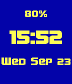

<!-- Generated by scripts/update_app_directory.py: do not edit by hand -->
[← All Pebble Developers](../developers.md)

# firekesti

*1 watchface · Last updated 2026-10-12 · [About these lists](../about-app-lists.md)*

Links: [Pebble App Store](https://apps.repebble.com/apps/dev/firekesti_557207fdfdb261eb76000084) · [GitHub (firekesti)](https://github.com/firekesti)

<h2 class="app-name" id="app-5602247f15706c9bfe000023"><a href="https://apps.repebble.com/5602247f15706c9bfe000023">Terran Watchface</a> v1.01</h2>
<a class="app-source" href="https://github.com/firekesti/TerranPebble" title="Source code" data-search-exclude>View source</a>

Watchface

MIT Released 2015-09-23 Updated 2015-09-23

Runs on: Time 2, Pebble 2 Duo, Pebble 2, Time, Classic

A simple watchface that uses a Terran font from Starcraft. Shows battery percentage, date, time, and will vibrate with a unique pattern when Bluetooth is disconnected, and two short buzzes when…

