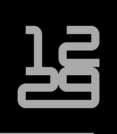
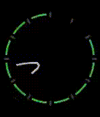

<!-- Generated by scripts/update_app_directory.py: do not edit by hand -->
[← All Pebble Developers](../developers.md)

# fish

*3 watchfaces · Last updated 2026-10-11 · [About these lists](../about-app-lists.md)*

Links: [Pebble App Store](https://apps.repebble.com/apps/dev/fish_682b987ec15d300009637d7d) · [GitHub (sockeye-d)](https://github.com/sockeye-d) · [Website (fishies.dev)](https://fishies.dev/)

<button type="button" data-filter="all" aria-pressed="true">All 3</button><button type="button" data-filter="watchface" aria-pressed="false">Watchfaces 3</button><button type="button" data-filter="watchapp" aria-pressed="false" disabled>Apps 0</button>

<label class="dev-sort">Sort by <select><option value="updated">Recently updated</option><option value="released">Newest release</option><option value="title">A–Z</option></select></label>

<h2 class="app-name" id="app-6951f2e5828bd90009267488"><a href="https://apps.repebble.com/6951f2e5828bd90009267488">Lexiclock</a> v1.6</h2>
<a class="app-source" href="https://github.com/sockeye-d/pebble-lexiclock/tree/main" title="Source code" data-search-exclude>View source</a>

Watchface · <a href="https://forum.rebble.io/t/380" title="Discuss this app on the Rebble forum" data-search-exclude>Forum thread</a>

Released 2025-12-29 Updated 2026-01-28

Runs on: Time 2, Pebble 2 Duo, Pebble 2, Time, Classic

A word clock for Basalt and Emery

<h2 class="app-name" id="app-693d5087c098f80009210c96"><a href="https://apps.repebble.com/693d5087c098f80009210c96">Breuer</a> v1.1</h2>
<a class="app-source" href="https://github.com/sockeye-d/pebble-breuer" title="Source code" data-search-exclude>View source</a>

Watchface · <a href="https://forum.rebble.io/t/244" title="Discuss this app on the Rebble forum" data-search-exclude>Forum thread</a>

Released 2025-12-13 Updated 2025-12-13

Runs on: Round 2, Time 2, Pebble 2 Duo, Pebble 2, Time Round, Time, Classic

Inspired by Nothing OS 4.0&#x27;s new lock screen clock face, named because it looks like Marcel Breuer&#x27;s chairs (from MotherWit on the Rebble Discord)

<h2 class="app-name" id="app-6834f92e6eeb590009984aa3"><a href="https://apps.repebble.com/6834f92e6eeb590009984aa3">Bezier</a> v1.1</h2>
<a class="app-source" href="https://github.com/sockeye-d/pebble-bezier" title="Source code" data-search-exclude>View source</a>

Watchface

Released 2025-05-26 Updated 2025-05-26

Runs on: Round 2, Time 2, Pebble 2 Duo, Pebble 2, Time Round, Time, Classic

it draw the hand bezierly

