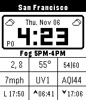

<!-- Generated by scripts/update_app_directory.py: do not edit by hand -->
[← All Pebble Developers](../developers.md)

# Fitzsky Inc

*1 watchface · Last updated 2026-10-12 · [About these lists](../about-app-lists.md)*

Links: [Rebble App Store](https://apps.rebble.io/en_US/developer/6864335b0c0ce600095a9437/1) · [GitHub (devindudeman)](https://github.com/devindudeman)

<h2 class="app-name" id="app-690e420aafb4ca00099364fe"><a href="https://apps.rebble.io/en_US/application/690e420aafb4ca00099364fe">Fitzface</a> v1.0</h2>
<a class="app-source" href="https://github.com/devindudeman/fitzface" title="Source code" data-search-exclude>View source</a>

Watchface

No licence Released 2025-11-07 Updated 2025-11-07 Rebble App Store

Runs on: Time 2, Pebble 2 Duo, Pebble 2, Time, Classic

FitzFace – High-Density Data Watchface A feature-packed Pebble watchface that brings weather, transit, and environmental data to your wrist in a compact, glanceable format. Displays current…

