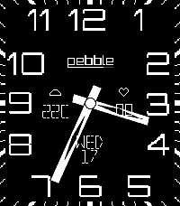

<!-- Generated by scripts/update_app_directory.py: do not edit by hand -->
[← All Pebble Developers](../developers.md)

# Flecmart

*1 watchface and 1 app · Last updated 2026-10-11 · [About these lists](../about-app-lists.md)*

Links: [Pebble App Store](https://apps.repebble.com/apps/dev/flecmart_56b2a154d47512b8de5ebcdd) · [GitHub (flecmart)](https://github.com/flecmart)

<button type="button" data-filter="all" aria-pressed="true">All 2</button><button type="button" data-filter="watchface" aria-pressed="false">Watchfaces 1</button><button type="button" data-filter="watchapp" aria-pressed="false">Apps 1</button>

<label class="dev-sort">Sort by <select><option value="updated">Recently updated</option><option value="released">Newest release</option><option value="title">A–Z</option></select></label>

<h2 class="app-name" id="app-5124bacb5baf4657be29a073"><a href="https://apps.repebble.com/5124bacb5baf4657be29a073">Modern PT2</a> v1.2.0</h2>
<a class="app-source" href="https://github.com/flecmart/modern_pt2" title="Source code" data-search-exclude>View source</a>

Watchface

Released 2026-06-17 Updated 2026-06-22

Runs on: Time 2

Modern PT2 - Modernized port of the classic &quot;Modern&quot; watchface by Zalew, rebuilt for Pebble SDK 4.x - Native 200×228 layout for Pebble Time 2 (Emery) - 3 configurable info slots (left, right…

<h2 class="app-name" id="app-4015983bf15545d6ad50803b"><a href="https://apps.repebble.com/4015983bf15545d6ad50803b">pebble2todoist</a> v1.0.0</h2>
<a class="app-source" href="https://github.com/flecmart/pebble2todoist" title="Source code" data-search-exclude>View source</a>

App

Released 2026-06-18 Updated 2026-06-18

Runs on: Round 2, Time 2, Pebble 2 Duo, Pebble 2, Time Round, Time, Classic

A Pebble watchapp that adds tasks to Todoist using your voice. Press SELECT, speak a command, and the task appears in your Todoist project — or in your Inbox with a &quot;today&quot; due date so it never…

