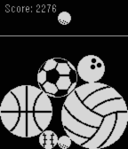
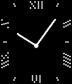

<!-- Generated by scripts/update_app_directory.py: do not edit by hand -->
[← All Pebble Developers](../developers.md)

# Flo Knödl

*1 watchface and 3 apps · Last updated 2026-10-12 · [About these lists](../about-app-lists.md)*

Links: [Pebble App Store](https://apps.repebble.com/apps/dev/flo-kn-dl_69207a520a015600086f2e44) · [Rebble App Store](https://apps.rebble.io/en_US/developer/69207a520a015600086f2e44/1) · [GitHub (flokndl)](https://github.com/flokndl) · [Website (faceswithlove.framer.ai)](https://faceswithlove.framer.ai/)

<button type="button" data-filter="all" aria-pressed="true">All 4</button><button type="button" data-filter="watchface" aria-pressed="false">Watchfaces 1</button><button type="button" data-filter="watchapp" aria-pressed="false">Apps 3</button>

<label class="dev-sort">Sort by <select><option value="updated">Recently updated</option><option value="released">Newest release</option><option value="title">A–Z</option></select></label>

<h2 class="app-name" id="app-c55bf63c1eed4b1d87558961"><a href="https://apps.repebble.com/c55bf63c1eed4b1d87558961">MiniSuika</a> v1.1</h2>
<a class="app-source" href="https://faceswithlove.framer.ai/" title="Source code" data-search-exclude>View source</a>

App

Released 2026-04-04 Updated 2026-04-05

Runs on: Pebble 2 Duo

Drop &amp; merge balls together before get over the line. How to play? - Drop a ball with the DOWN button - Balls of the same type will merge on contact - Try to keep all balls under the white line

<h2 class="app-name" id="app-6948196e16fdf5000991cbc4"><a href="https://apps.repebble.com/6948196e16fdf5000991cbc4">Level</a> v1.0</h2>
<a class="app-source" href="https://github.com/flokndl/level-watchapp" title="Source code" data-search-exclude>View source</a>

App · <a href="https://forum.rebble.io/t/330" title="Discuss this app on the Rebble forum" data-search-exclude>Forum thread</a>

No licence Released 2025-12-21 Updated 2025-12-21

Runs on: Time 2, Pebble 2 Duo, Pebble 2, Time, Classic

A simple Level measuring tool. - Simply tilt the watch to measure - At 0° Level is a subtle nudge vibration

<h2 class="app-name" id="app-6946aed4da15010009fbaa7c"><a href="https://apps.repebble.com/6946aed4da15010009fbaa7c">Chronograph</a> v1.4</h2>
<a class="app-source" href="https://github.com/flokndl/chronograph" title="Source code" data-search-exclude>View source</a>

App · <a href="https://forum.rebble.io/t/321" title="Discuss this app on the Rebble forum" data-search-exclude>Forum thread</a>

No licence Released 2025-12-20 Updated 2025-12-20

Runs on: Time 2, Pebble 2 Duo, Pebble 2, Time, Classic

Chronograph Stopwatch based on &#x27;analogue dots&#x27; Watchface. --- - press &#x27;down&#x27; for start/pause/resume - press &#x27;up&#x27; for reset Display: - large hand for &#x27;seconds - small left dial for &#x27;subseconds&#x27; …

<h2 class="app-name" id="app-69343ba1bd6440000946e487"><a href="https://apps.rebble.io/en_US/application/69343ba1bd6440000946e487">Analogue Dots</a> v1.5</h2>
<a class="app-source" href="https://github.com/flokndl/watchface-analogue-dots" title="Source code" data-search-exclude>View source</a>

Watchface · <a href="https://forum.rebble.io/t/104" title="Discuss this app on the Rebble forum" data-search-exclude>Forum thread</a>

No licence Released 2025-12-06 Updated 2025-12-20 Rebble App Store

Runs on: Time 2, Pebble 2 Duo, Pebble 2

Simple analoge watchface with two style. -- Now with Chronomode -- Activate it settings -&gt; tap/flick starts seconds&amp;minute stopwatch. -&gt; if persistent mode is active tap/flick resets chrono.

