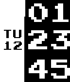

<!-- Generated by scripts/update_app_directory.py: do not edit by hand -->
[← All Pebble Developers](../developers.md)

# flogo

*1 watchface · Last updated 2026-10-12 · [About these lists](../about-app-lists.md)*

Links: [Pebble App Store](https://apps.repebble.com/apps/dev/flogo_5491ccc0f94ab3937f0000ee) · [GitHub (fgolemo)](https://github.com/fgolemo)

<h2 class="app-name" id="app-5692f973a45b56bdcb000008"><a href="https://apps.repebble.com/5692f973a45b56bdcb000008">Arrow</a> v1.3</h2>
<a class="app-source" href="https://github.com/fgolemo/pebble-face-arrow" title="Source code" data-search-exclude>View source</a>

Watchface

No licence Released 2016-01-11 Updated 2016-02-12

Runs on: Round 2, Time 2, Pebble 2 Duo, Pebble 2, Time Round, Time, Classic

Simple retro digital watchface with pixel art font. Now with battery indicator (thin black line at the border between black and white, full = black, low = white). If you want some optional…

