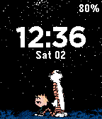
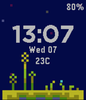

<!-- Generated by scripts/update_app_directory.py: do not edit by hand -->
[← All Pebble Developers](../developers.md)

# Florencia Tarditti

*2 watchfaces · Last updated 2026-10-12 · [About these lists](../about-app-lists.md)*

Links: [Pebble App Store](https://apps.repebble.com/apps/dev/florencia-tarditti_55e2ea2fe1fe97a55c00001c) · [GitHub (formap)](https://github.com/formap)

<button type="button" data-filter="all" aria-pressed="true">All 2</button><button type="button" data-filter="watchface" aria-pressed="false">Watchfaces 2</button><button type="button" data-filter="watchapp" aria-pressed="false" disabled>Apps 0</button>

<label class="dev-sort">Sort by <select><option value="updated">Recently updated</option><option value="released">Newest release</option><option value="title">A–Z</option></select></label>

<h2 class="app-name" id="app-5687ab3322c220343900008e"><a href="https://apps.repebble.com/5687ab3322c220343900008e">Calvin and Hobbes</a> v1.0</h2>
<a class="app-source" href="https://github.com/formap/pebble-calvin-hobbes-starry-night" title="Source code" data-search-exclude>View source</a>

Watchface

MIT Released 2016-01-02 Updated 2016-01-02

Runs on: Time 2, Pebble 2 Duo, Pebble 2, Time, Classic

A Calvin and Hobbes inspired pebble watchface. For issues or requests, you can contact me with the links below or send me a tweet @_formap.

<h2 class="app-name" id="app-55e2ec06c18b95fd44000019"><a href="https://apps.repebble.com/55e2ec06c18b95fd44000019">Pixel Grass</a> v3.0</h2>
<a class="app-source" href="https://github.com/formap/pebble-pixel-grass" title="Source code" data-search-exclude>View source</a>

Watchface

MIT Released 2015-08-30 Updated 2015-10-07

Runs on: Time 2, Pebble 2 Duo, Pebble 2, Time, Classic

A pebble watchface featuring a Fez inspired pixel art background. Supports weather in both celsius and fahrenheit and can be configured to emit hourly vibrations. For issues or requests, you can…

