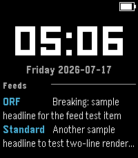

<!-- Generated by scripts/update_app_directory.py: do not edit by hand -->
[← All Pebble Developers](../developers.md)

# Florian Klug-Göri

*1 watchface · Last updated 2026-10-12 · [About these lists](../about-app-lists.md)*

Links: [Pebble App Store](https://apps.repebble.com/apps/dev/florian-klug-g-ri_ae55f651e081074fcd7a66e2) · [GitHub (flurl)](https://github.com/flurl)

<h2 class="app-name" id="app-1ea3cd25c8e94d1581b5c0d8"><a href="https://apps.repebble.com/1ea3cd25c8e94d1581b5c0d8">Infoface</a> v0.9.0</h2>
<a class="app-source" href="https://github.com/flurl/infoface-watchface" title="Source code" data-search-exclude>View source</a>

Watchface

GPL-3.0 Released 2026-07-17 Updated 2026-07-17

Runs on: Round 2, Time 2, Pebble 2 Duo

Calendar, weather, RSS/Atom feeds, and JSON — up to 4 rotating info panels on your watch face. Infoface turns your watch face into a small live dashboard. Configure up to four independent info…

