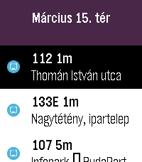

<!-- Generated by scripts/update_app_directory.py: do not edit by hand -->
[← All Pebble Developers](../developers.md)

# FlyinPancake

*1 app · Last updated 2026-10-11 · [About these lists](../about-app-lists.md)*

Links: [Pebble App Store](https://apps.repebble.com/apps/dev/flyinpancake_a626469556fb9e4c7f3cadaa) · [GitHub (FlyinPancake)](https://github.com/FlyinPancake)

<h2 class="app-name" id="app-c48a055647ef4dbeb13daf66"><a href="https://apps.repebble.com/c48a055647ef4dbeb13daf66">Pest Stop</a> v0.0.1</h2>
<a class="app-source" href="https://github.com/FlyinPancake/pest-stop" title="Source code" data-search-exclude>View source</a>

App

No licence Released 2026-04-19 Updated 2026-04-19

Runs on: Round 2, Time 2, Pebble 2 Duo, Pebble 2, Time Round, Time

Your wrist-sized companion for the Budapest Transit system

