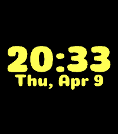
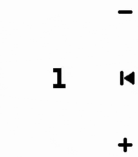
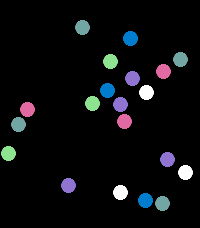
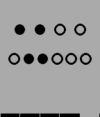

<!-- Generated by scripts/update_app_directory.py: do not edit by hand -->
[← All Pebble Developers](../developers.md)

# Flynn Duniho

*5 watchfaces and 6 apps · Last updated 2026-10-12 · [About these lists](../about-app-lists.md)*

Links: [Rebble App Store](https://apps.rebble.io/en_US/developer/67bd48a737d408000a74f7d7/1) · [Pebble App Store](https://apps.repebble.com/apps/dev/flynn-duniho_67bd48a737d408000a74f7d7) · [GitHub (FlynnD273)](https://github.com/FlynnD273) · [Website (flynnd273.github.io)](https://flynnd273.github.io/)

<button type="button" data-filter="all" aria-pressed="true">All 11</button><button type="button" data-filter="watchface" aria-pressed="false">Watchfaces 5</button><button type="button" data-filter="watchapp" aria-pressed="false">Apps 6</button>

<label class="dev-sort">Sort by <select><option value="updated">Recently updated</option><option value="released">Newest release</option><option value="title">A–Z</option></select></label>

<h2 class="app-name" id="app-6959fce216fdf50009c6a89f"><a href="https://apps.rebble.io/en_US/application/6959fce216fdf50009c6a89f">Nomai</a> v2.02.2</h2>
<a class="app-source" href="https://github.com/flynnD273/pebble-nomai" title="Source code" data-search-exclude>View source</a>

Watchface · <a href="https://forum.rebble.io/t/436" title="Discuss this app on the Rebble forum" data-search-exclude>Forum thread</a>

No licence Released 2026-01-04 Updated 2026-07-10 Rebble App Store

Runs on: Round 2, Time 2, Pebble 2 Duo, Pebble 2, Time Round, Time, Classic

Inspired by Outer Wilds, this displays a Nomai mask when idle, and shows the time, date, and battery level upon shaking.

<h2 class="app-name" id="app-682ecefc435cc40009e73634"><a href="https://apps.rebble.io/en_US/application/682ecefc435cc40009e73634">Bad Apple!!</a> v2.1.0</h2>
<a class="app-source" href="https://github.com/FlynnD273/pebble-bad-apple" title="Source code" data-search-exclude>View source</a>

App · <a href="https://forum.rebble.io/t/737" title="Discuss this app on the Rebble forum" data-search-exclude>Forum thread</a>

No licence Released 2025-05-22 Updated 2026-05-11 Rebble App Store

Runs on: Round 2, Time 2, Pebble 2 Duo, Pebble 2, Time Round, Time, Classic

Displays the full Bad Apple!! animation on the watch, completely locally. No streaming files from the phone or the internet.

<h2 class="app-name" id="app-69d9d794afd84300099c2003"><a href="https://apps.rebble.io/en_US/application/69d9d794afd84300099c2003">Metaballs</a> v1.0</h2>
<a class="app-source" href="https://github.com/flynnd273/pebble-metaballs" title="Source code" data-search-exclude>View source</a>

App · <a href="https://forum.rebble.io/t/852" title="Discuss this app on the Rebble forum" data-search-exclude>Forum thread</a>

No licence Released 2026-04-11 Updated 2026-04-11 Rebble App Store

Runs on: Round 2, Time 2, Pebble 2 Duo, Pebble 2, Time Round, Time, Classic

Play with a bouncy metaball! It kinda merges together with the other one lol

<h2 class="app-name" id="app-69d08546afd8430009d9a1ef"><a href="https://apps.rebble.io/en_US/application/69d08546afd8430009d9a1ef">Sands of Time</a> v1.2</h2>
<a class="app-source" href="https://github.com/FlynnD273/pebble-sands-of-time" title="Source code" data-search-exclude>View source</a>

Watchface · <a href="https://forum.rebble.io/t/824" title="Discuss this app on the Rebble forum" data-search-exclude>Forum thread</a>

No licence Released 2026-04-04 Updated 2026-04-10 Rebble App Store

Runs on: Round 2, Time 2, Pebble 2 Duo, Pebble 2, Time Round, Time, Classic

Combines a sand simulator with a simple watchface.

<h2 class="app-name" id="app-69840d77623fe200090616d3"><a href="https://apps.repebble.com/69840d77623fe200090616d3">Smooth Counter</a> v1.2</h2>
<a class="app-source" href="https://github.com/FlynnD273/smooth-counter" title="Source code" data-search-exclude>View source</a>

App · <a href="https://forum.rebble.io/t/614" title="Discuss this app on the Rebble forum" data-search-exclude>Forum thread</a>

No licence Released 2026-02-05 Updated 2026-03-03

Runs on: Round 2, Time 2, Pebble 2 Duo, Pebble 2, Time Round, Time, Classic

A simple counter app with nice animations that lets you highlight every N numbers.

<h2 class="app-name" id="app-67ddcf03d8284900098ed1a4"><a href="https://apps.rebble.io/en_US/application/67ddcf03d8284900098ed1a4">QR Generator</a> v2.10</h2>
<a class="app-source" href="https://github.com/flynnD273/pebble-qr" title="Source code" data-search-exclude>View source</a>

App · <a href="https://forum.rebble.io/t/547" title="Discuss this app on the Rebble forum" data-search-exclude>Forum thread</a>

No licence Released 2025-03-21 Updated 2026-03-03 Rebble App Store

Runs on: Round 2, Time 2, Pebble 2 Duo, Pebble 2, Time Round, Time, Classic

Display configurable QR codes from your watch

<h2 class="app-name" id="app-67ccf9b0d2acb302d5ba8210"><a href="https://apps.rebble.io/en_US/application/67ccf9b0d2acb302d5ba8210">Particles</a> v1.4</h2>
<a class="app-source" href="https://github.com/FlynnD273/pebble-physics" title="Source code" data-search-exclude>View source</a>

App · <a href="https://forum.rebble.io/t/736" title="Discuss this app on the Rebble forum" data-search-exclude>Forum thread</a>

MIT Released 2025-03-09 Updated 2026-03-03 Rebble App Store

Runs on: Round 2, Time 2, Pebble 2 Duo, Pebble 2, Time Round, Time, Classic

Just a physics sim with a bunch of balls, uses the accelerometer

<h2 class="app-name" id="app-67c5071bb7a02300092ba08c"><a href="https://apps.rebble.io/en_US/application/67c5071bb7a02300092ba08c">Orbit</a> v1.10</h2>
<a class="app-source" href="https://github.com/flynnD273/orbit" title="Source code" data-search-exclude>View source</a>

Watchface · <a href="https://forum.rebble.io/t/735" title="Discuss this app on the Rebble forum" data-search-exclude>Forum thread</a>

MIT Released 2025-03-03 Updated 2026-03-03 Rebble App Store

Runs on: Round 2, Time 2, Pebble 2 Duo, Pebble 2, Time Round, Time, Classic

A space-themed watchface where the positions of the celestial bodies represent the time. The large orbit also serves as a battery level indicator.

<h2 class="app-name" id="app-67d320fcd3b7b300097f1ec4"><a href="https://apps.rebble.io/en_US/application/67d320fcd3b7b300097f1ec4">Conway&#x27;s Game of Life</a> v1.5</h2>
<a class="app-source" href="https://github.com/FlynnD273/pebble-conway" title="Source code" data-search-exclude>View source</a>

App · <a href="https://forum.rebble.io/t/738" title="Discuss this app on the Rebble forum" data-search-exclude>Forum thread</a>

No licence Released 2025-03-13 Updated 2026-03-03 Rebble App Store

Runs on: Round 2, Time 2, Pebble 2 Duo, Pebble 2, Time Round, Time, Classic

A simple Conway&#x27;s Game of Life app

<h2 class="app-name" id="app-67c230eeb7a02300092ba04a"><a href="https://apps.rebble.io/en_US/application/67c230eeb7a02300092ba04a">Simple Purple</a> v1.2</h2>
<a class="app-source" href="https://github.com/FlynnD273/pebble-watchface" title="Source code" data-search-exclude>View source</a>

Watchface

MIT Released 2025-02-28 Updated 2025-03-02 Rebble App Store

Runs on: Round 2, Time 2, Pebble 2 Duo, Pebble 2, Time Round, Time, Classic

A simple purple (on colour displays) watchface that shows the time and battery level.

<h2 class="app-name" id="app-67c1f6e2d2acb30009a3c793"><a href="https://apps.rebble.io/en_US/application/67c1f6e2d2acb30009a3c793">Binary</a> v1.2</h2>
<a class="app-source" href="https://github.com/flynnD273/binary-watchface" title="Source code" data-search-exclude>View source</a>

Watchface

MIT Released 2025-02-28 Updated 2025-03-02 Rebble App Store

Runs on: Round 2, Time 2, Pebble 2 Duo, Pebble 2, Time Round, Time, Classic

Displays the time in binary

