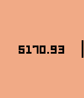

<!-- Generated by scripts/update_app_directory.py: do not edit by hand -->
[← All Pebble Developers](../developers.md)

# fork from David Gianforte

*1 watchface and 1 app · Last updated 2026-10-11 · [About these lists](../about-app-lists.md)*

Links: [Rebble App Store](https://apps.rebble.io/en_US/developer/607dad8b1342ae005a8a9b2a/1) · [GitHub (zhcong)](https://github.com/zhcong)

<button type="button" data-filter="all" aria-pressed="true">All 2</button><button type="button" data-filter="watchface" aria-pressed="false">Watchfaces 1</button><button type="button" data-filter="watchapp" aria-pressed="false">Apps 1</button>

<label class="dev-sort">Sort by <select><option value="updated">Recently updated</option><option value="released">Newest release</option><option value="title">A–Z</option></select></label>

<h2 class="app-name" id="app-60803e261342ae0104101db3"><a href="https://apps.rebble.io/en_US/application/60803e261342ae0104101db3">doge-balance</a> v1.0</h2>
<a class="app-source" href="https://github.com/zhcong/doge-balance" title="Source code" data-search-exclude>View source</a>

App

Released 2021-04-21 Updated 2021-04-21 Rebble App Store

Runs on: Time 2, Time

doge-balance is a app that show your dogecoin amount, it can also show in local currency.

<h2 class="app-name" id="app-607dad8e1342ae005a8a9b2c"><a href="https://apps.rebble.io/en_US/application/607dad8e1342ae005a8a9b2c">pebble-day-night-pix</a> v1.6</h2>
<a class="app-source" href="https://github.com/zhcong/pebble-day-night-pix" title="Source code" data-search-exclude>View source</a>

Watchface

Released 2021-04-19 Updated 2021-04-19 Rebble App Store

Runs on: Time 2, Pebble 2 Duo, Pebble 2, Time, Classic

fork from watchface pebble-day-night, this is a day-night map pix edition for you! And DIY this watchface by github source code.

