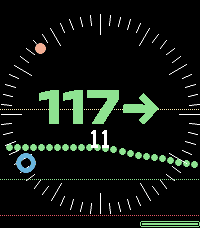

<!-- Generated by scripts/update_app_directory.py: do not edit by hand -->
[← All Pebble Developers](../developers.md)

# Fossy

*1 watchface · Last updated 2026-10-12 · [About these lists](../about-app-lists.md)*

Links: [Pebble App Store](https://apps.repebble.com/apps/dev/fossy_23c0d59ca1804bc25afb73aa) · [Codeberg (fossy)](https://codeberg.org/fossy)

<h2 class="app-name" id="app-273afcf8d8fe48629f136b43"><a href="https://apps.repebble.com/273afcf8d8fe48629f136b43">round-nightscout</a> v1.2.0</h2>
<a class="app-source" href="https://codeberg.org/fossy/pebble-round-nightscout/src/branch/main" title="Source code" data-search-exclude>View source</a>

Watchface

Released 2026-08-30 Updated 2026-09-11

Runs on: Round 2, Time 2, Pebble 2 Duo, Pebble 2, Time Round, Time, Classic

It shows a round clockface with your blood sugar from nightscout together with the last values as line in the background.

