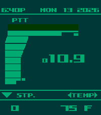

<!-- Generated by scripts/update_app_directory.py: do not edit by hand -->
[← All Pebble Developers](../developers.md)

# FouzR

*1 watchface · Last updated 2026-10-12 · [About these lists](../about-app-lists.md)*

Links: [Pebble App Store](https://apps.repebble.com/apps/dev/fouzr_f95df6bca581318f0e221894) · [GitHub (FouzR)](https://github.com/FouzR) · [Website (ko-fi.com)](https://ko-fi.com/FouzR)

<h2 class="app-name" id="app-5eb5c96eb62346b3b041ca37"><a href="https://apps.repebble.com/5eb5c96eb62346b3b041ca37">mgs-codec</a> v1.2.0</h2>
<a class="app-source" href="https://github.com/FouzR/mgs-codec-pebble" title="Source code" data-search-exclude>View source</a>

Watchface · <a href="https://forum.rebble.io/t/869" title="Discuss this app on the Rebble forum" data-search-exclude>Forum thread</a>

No licence Released 2026-04-13 Updated 2026-08-03

Runs on: Time 2

MGS Codec inspired watchface Features - Sunrise/Sunset times on the top left corner - Long date on the top right corner( Mon 10 2026) - Steps on the bottom left corner - Temperature on the bottom…

