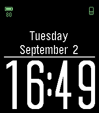
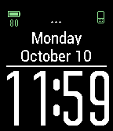
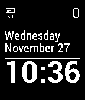

<!-- Generated by scripts/update_app_directory.py: do not edit by hand -->
[← All Pebble Developers](../developers.md)

# Foxel

*3 watchfaces · Last updated 2026-10-12 · [About these lists](../about-app-lists.md)*

Links: [Pebble App Store](https://apps.repebble.com/apps/dev/foxel_52a9613fc0ca935e83000032) · [GitHub (foxel)](https://github.com/foxel)

<button type="button" data-filter="all" aria-pressed="true">All 3</button><button type="button" data-filter="watchface" aria-pressed="false">Watchfaces 3</button><button type="button" data-filter="watchapp" aria-pressed="false" disabled>Apps 0</button>

<label class="dev-sort">Sort by <select><option value="updated">Recently updated</option><option value="released">Newest release</option><option value="title">A–Z</option></select></label>

<h2 class="app-name" id="app-5393e248553ec92366000001"><a href="https://apps.repebble.com/5393e248553ec92366000001">Simple F Big</a> v1.11</h2>
<a class="app-source" href="https://github.com/foxel/pebble-simple-big" title="Source code" data-search-exclude>View source</a>

Watchface

No licence Released 2014-06-08 Updated 2025-09-02

Runs on: Round 2, Time 2, Pebble 2 Duo, Pebble 2, Time Round, Time, Classic

Simple watchface based on simplicity and big watch. Features: * BIG time display * 12/24-h mode * battery-efficient rendering * week day display * battery indicator * bluetooth indicator *…

<h2 class="app-name" id="app-54affcb0a1eea169e600009f"><a href="https://apps.repebble.com/54affcb0a1eea169e600009f">Simple F + termopogoda.ru</a> v1.5</h2>
<a class="app-source" href="https://github.com/foxel/pebble-simple-termo" title="Source code" data-search-exclude>View source</a>

Watchface

No licence Released 2015-01-09 Updated 2017-04-11

Runs on: Round 2, Time 2, Pebble 2 Duo, Pebble 2, Time Round, Time, Classic

Simple F with http://termopogoda.ru weather info. SHOWS ONLY TOMSK WEATHER Features: * BIG time display * 12/24-h mode * battery-efficient rendering * week day display * battery indicator *…

<h2 class="app-name" id="app-52a9641079c18f0ed9000048"><a href="https://apps.repebble.com/52a9641079c18f0ed9000048">Simple F</a> v1.9</h2>
<a class="app-source" href="https://github.com/foxel/pebble-simplef" title="Source code" data-search-exclude>View source</a>

Watchface

No licence Released 2013-12-12 Updated 2017-04-11

Runs on: Time 2, Pebble 2 Duo, Pebble 2, Time, Classic

Simple watchface based on simplicity. Features: * battery-efficient rendering * week day display * battery indicator * bluetooth indicator * connection break indicator and vibe * easy colors…

