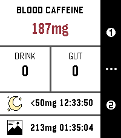

<!-- Generated by scripts/update_app_directory.py: do not edit by hand -->
[← All Pebble Developers](../developers.md)

# FPuzeras

*1 app · Last updated 2026-10-11 · [About these lists](../about-app-lists.md)*

Links: [Pebble App Store](https://apps.repebble.com/apps/dev/fpuzeras_6b584e89538a8246ca644902) · [GitHub (FPuzeras)](https://github.com/FPuzeras)

<h2 class="app-name" id="app-abd6da93b862465d836185e6"><a href="https://apps.repebble.com/abd6da93b862465d836185e6">HalfLife - Smart Caffeine Tracker</a> v0.5</h2>
<a class="app-source" href="https://github.com/FPuzeras/HalfLife" title="Source code" data-search-exclude>View source</a>

App

AGPL-3.0 Released 2026-04-12 Updated 2026-04-16

Runs on: Time 2, Pebble 2 Duo, Pebble 2, Time, Classic

Track your caffeine like your body actually processes it. HalfLife is a real-time caffeine tracker for Pebble that simulates how caffeine is absorbed, peaks, and wears off — so you can stay…

