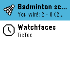

<!-- Generated by scripts/update_app_directory.py: do not edit by hand -->
[← All Pebble Developers](../developers.md)

# FraBo

*1 app · Last updated 2026-10-12 · [About these lists](../about-app-lists.md)*

Links: [Pebble App Store](https://apps.repebble.com/apps/dev/frabo_56d8b0e51d085fb31d00002a) · [GitHub (FraBoCH)](https://github.com/FraBoCH)

<h2 class="app-name" id="app-574356ddb4818474a6000013"><a href="https://apps.repebble.com/574356ddb4818474a6000013">Badminton score</a> v1.2</h2>
<a class="app-source" href="https://github.com/FraBoCH/pebble-badminton/" title="Source code" data-search-exclude>View source</a>

App

BSD-3-Clause Released 2016-05-23 Updated 2016-09-14

Runs on: Time 2, Pebble 2 Duo, Pebble 2, Time, Classic

An easy to use pebble app to count the points during your badminton game. Hit the bottom button when you score, the top button when your opponent scores. The final score will be displayed at the…

