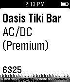

<!-- Generated by scripts/update_app_directory.py: do not edit by hand -->
[← All Pebble Developers](../developers.md)

# Frank Michael Sanchez

*1 app · Last updated 2026-10-11 · [About these lists](../about-app-lists.md)*

Links: [Pebble App Store](https://apps.repebble.com/apps/dev/frank-michael-sanchez_52f029211ac794870800095d) · [GitHub (fmscode)](https://github.com/fmscode) · [Website (pinballmap.com)](http://pinballmap.com)

<h2 class="app-name" id="app-54c14c00bcd4c7b7ca000069"><a href="https://apps.repebble.com/54c14c00bcd4c7b7ca000069">Pinball Map</a> v1.0</h2>
<a class="app-source" href="https://github.com/fmscode/pbm-pebble" title="Source code" data-search-exclude>View source</a>

App

Released 2015-01-22 Updated 2015-01-25

Runs on: Time 2, Pebble 2 Duo, Pebble 2, Time, Classic

Find nearby pinball machines! The Pinball Map Pebble App tells you the closest places to play pinball, as well as which machines have been recently added to spots. You can also use it to find…

