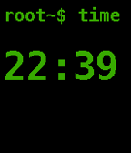

<!-- Generated by scripts/update_app_directory.py: do not edit by hand -->
[← All Pebble Developers](../developers.md)

# Frank Prins

*1 watchface · Last updated 2026-10-12 · [About these lists](../about-app-lists.md)*

Links: [Pebble App Store](https://apps.repebble.com/apps/dev/frank-prins_5571f66b2cf3a3c2b7000071) · [GitHub (twodogwalker)](https://github.com/twodogwalker)

<h2 class="app-name" id="app-5618284f1d9c8c20f900001b"><a href="https://apps.repebble.com/5618284f1d9c8c20f900001b">Unix style</a> v1.2</h2>
<a class="app-source" href="https://github.com/twodogwalker/PebbleFace_Ux" title="Source code" data-search-exclude>View source</a>

Watchface

Released 2015-10-09 Updated 2015-11-11

Runs on: Time 2, Pebble 2 Duo, Pebble 2, Time, Classic

A first playing around face, inspired by Unix interfacing. It is quite like the other you will find around here, named Terminal etc. Oh, and yes, I am aware the unix commands shown are not valid…

