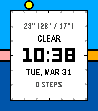
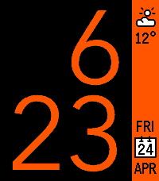
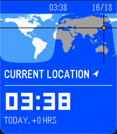
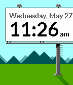

<!-- Generated by scripts/update_app_directory.py: do not edit by hand -->
[← All Pebble Developers](../developers.md)

# Freakified

*4 watchfaces and 4 apps · Last updated 2026-10-12 · [About these lists](../about-app-lists.md)*

Links: [Pebble App Store](https://apps.repebble.com/apps/dev/freakified_534d74f861fcaa8033000263) · [Rebble App Store](https://apps.rebble.io/en_US/developer/534d74f861fcaa8033000263/1) · [GitHub (freakified)](https://github.com/freakified)

<button type="button" data-filter="all" aria-pressed="true">All 8</button><button type="button" data-filter="watchface" aria-pressed="false">Watchfaces 4</button><button type="button" data-filter="watchapp" aria-pressed="false">Apps 4</button>

<label class="dev-sort">Sort by <select><option value="updated">Recently updated</option><option value="released">Newest release</option><option value="title">A–Z</option></select></label>

<h2 class="app-name" id="app-5620e876768e7ada4e00007a"><a href="https://apps.repebble.com/5620e876768e7ada4e00007a">Checklist</a> v2.5.2</h2>
<a class="app-source" href="https://github.com/freakified/PebbleChecklist" title="Source code" data-search-exclude>View source</a>

App · <a href="https://forum.rebble.io/t/703" title="Discuss this app on the Rebble forum" data-search-exclude>Forum thread</a>

MIT Released 2015-10-16 Updated 2026-10-07

Runs on: Round 2, Time 2, Pebble 2 Duo, Pebble 2, Time Round, Time

A checklist on your watch! Grocery shopping will never be the same. You can use Checklist to keep track of anything you need without needing to hold your phone: things to-do, shopping, and more!…

<h2 class="app-name" id="app-10966bb2d22145c4b428dfd7"><a href="https://apps.repebble.com/10966bb2d22145c4b428dfd7">Calculator</a> v2.0.0</h2>
<a class="app-source" href="https://github.com/freakified/pebble-calculator/" title="Source code" data-search-exclude>View source</a>

App · <a href="https://forum.rebble.io/t/939" title="Discuss this app on the Rebble forum" data-search-exclude>Forum thread</a>

MIT Released 2026-05-02 Updated 2026-07-24

Runs on: Round 2, Time 2

A calculator! On a watch! No one has ever thought of this before! Anyway, now that the Pebble Time 2&#x27;s touchscreen is enabled, let&#x27;s CALCULATE! Calculator allows to perform basic math operations…

<h2 class="app-name" id="app-67cb1c5fb7a02301b9a6e415"><a href="https://apps.repebble.com/67cb1c5fb7a02301b9a6e415">Halcyon</a> v2.3.1</h2>
<a class="app-source" href="https://github.com/freakified/halcyon" title="Source code" data-search-exclude>View source</a>

Watchface · <a href="https://forum.rebble.io/t/750" title="Discuss this app on the Rebble forum" data-search-exclude>Forum thread</a>

MIT Released 2025-03-07 Updated 2026-07-06

Runs on: Round 2, Time 2, Pebble 2 Duo, Pebble 2, Time Round, Time, Classic

An analog-digital watchface featuring the solar day! Halcyon represents the 24 hours of the day as a ring around the edges of your watch, highlighting the sunrise, sunset, and the position of the…

<h2 class="app-name" id="app-55a5c024f4510f794c000071"><a href="https://apps.repebble.com/55a5c024f4510f794c000071">TimeStyle</a> v7.11.2</h2>
<a class="app-source" href="https://github.com/freakified/TimeStylePebble" title="Source code" data-search-exclude>View source</a>

Watchface · <a href="https://forum.rebble.io/t/906" title="Discuss this app on the Rebble forum" data-search-exclude>Forum thread</a>

MIT Released 2015-07-15 Updated 2026-06-05

Runs on: Round 2, Time 2, Pebble 2 Duo, Pebble 2, Time Round, Time, Classic

Digital. Readable. Completely customizable. *** New for 2026: Full support for Time 2 and Round 2! *** The Timeline handles the past and the future: let TimeStyle handle your present! • Time you…

<h2 class="app-name" id="app-50caf7145cc2474da2aaf6cc"><a href="https://apps.repebble.com/50caf7145cc2474da2aaf6cc">Time Traveler - World Clock</a> v1.6.1</h2>
<a class="app-source" href="https://github.com/freakified/time-traveler/" title="Source code" data-search-exclude>View source</a>

App

MIT Released 2026-04-06 Updated 2026-05-22

Runs on: Round 2, Time 2, Pebble 2 Duo, Pebble 2, Time Round, Time

Remember the old days, when your digital watch would come preloaded with 49 cities of the world, and a world map prominently displayed on the screen? Wasn&#x27;t it fun to just scroll through all those…

<h2 class="app-name" id="app-69d3a680a6ffe6000a092d42"><a href="https://apps.rebble.io/en_US/application/69d3a680a6ffe6000a092d42">Time Traveler</a> v1.6.1</h2>
<a class="app-source" href="https://github.com/freakified/time-traveler/" title="Source code" data-search-exclude>View source</a>

App · <a href="https://forum.rebble.io/t/836" title="Discuss this app on the Rebble forum" data-search-exclude>Forum thread</a>

MIT Released 2026-04-06 Updated 2026-05-22 Rebble App Store

Runs on: Round 2, Time 2, Pebble 2 Duo, Pebble 2, Time Round, Time

Remember the old days, when your digital watch would come preloaded with 49 cities of the world, and a world map prominently displayed on the screen? Wasn&#x27;t it fun to just scroll through all those…

<h2 class="app-name" id="app-97bc032c51614549b3c33200"><a href="https://apps.repebble.com/97bc032c51614549b3c33200">Japanese Date &amp; Time Practice</a> v1.1</h2>
<a class="app-source" href="https://github.com/freakified/japanese-date-time-practice" title="Source code" data-search-exclude>View source</a>

Watchface · <a href="https://forum.rebble.io/t/861" title="Discuss this app on the Rebble forum" data-search-exclude>Forum thread</a>

MIT Released 2026-04-12 Updated 2026-04-13

Runs on: Round 2, Time 2, Pebble 2 Duo, Pebble 2, Time Round, Time, Classic

Inspired by JR&#x27;s Platform Signage, you can use this watchface to learn the proper way to pronounce dates and times in Japanese! No language pack required! Japanese Time &amp; Date Practice is a Pebble…

<h2 class="app-name" id="app-55665903f1a1c775170000d2"><a href="https://apps.repebble.com/55665903f1a1c775170000d2">Pixel Billboard</a> v1.1</h2>
<a class="app-source" href="https://github.com/freakified/PebblePixelBillboard" title="Source code" data-search-exclude>View source</a>

Watchface

No licence Released 2015-05-27 Updated 2015-07-19

Runs on: Time 2, Pebble 2 Duo, Pebble 2, Time, Classic

Watch the day pass by on the Pixel Billboard! • 3 different times of day • Sky changes update in real time using sunrise and sunset • Works in airplane mode: as long as the watchface has…

