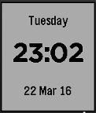

<!-- Generated by scripts/update_app_directory.py: do not edit by hand -->
[← All Pebble Developers](../developers.md)

# Fred Crowson

*1 watchface · Last updated 2026-10-12 · [About these lists](../about-app-lists.md)*

Links: [Pebble App Store](https://apps.repebble.com/apps/dev/fred-crowson_56efda6bf6ee241df5000035) · [GitHub (fcbsd)](https://github.com/fcbsd)

<h2 class="app-name" id="app-56f1d34bdf91bb2e83000012"><a href="https://apps.repebble.com/56f1d34bdf91bb2e83000012">Simple British Default</a> v1.0</h2>
<a class="app-source" href="https://github.com/fcbsd/Pebble" title="Source code" data-search-exclude>View source</a>

Watchface

ISC Released 2016-03-22 Updated 2016-03-22

Runs on: Time 2, Pebble 2 Duo, Pebble 2, Time, Classic

Simple British Default Watch with Day, Time and Date.

