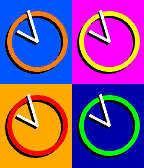

<!-- Generated by scripts/update_app_directory.py: do not edit by hand -->
[← All Pebble Developers](../developers.md)

# frogamic

*2 watchfaces · Last updated 2026-10-11 · [About these lists](../about-app-lists.md)*

Links: [Pebble App Store](https://apps.repebble.com/apps/dev/frogamic_55015e7e7ed24a01d400000c) · [GitHub (frogamic)](https://github.com/frogamic)

<button type="button" data-filter="all" aria-pressed="true">All 2</button><button type="button" data-filter="watchface" aria-pressed="false">Watchfaces 2</button><button type="button" data-filter="watchapp" aria-pressed="false" disabled>Apps 0</button>

<label class="dev-sort">Sort by <select><option value="updated">Recently updated</option><option value="released">Newest release</option><option value="title">A–Z</option></select></label>

<h2 class="app-name" id="app-55a23c67c6cca772db000007"><a href="https://apps.repebble.com/55a23c67c6cca772db000007">4pop</a> v1.0</h2>
<a class="app-source" href="https://github.com/frogamic/4pop" title="Source code" data-search-exclude>View source</a>

Watchface

Released 2015-07-12 Updated 2015-07-18

Runs on: Time 2, Time

A colourful Andy Warhol inspired pop-art face. This 4-up face lets you set the colour of each background, ring and set of hands so you can customise it to your heart&#x27;s content. Background or ring…

<h2 class="app-name" id="app-5572b7287d6f3d4845000017"><a href="https://apps.repebble.com/5572b7287d6f3d4845000017">About time</a> v1.3</h2>
<a class="app-source" href="https://github.com/frogamic/abouttime" title="Source code" data-search-exclude>View source</a>

Watchface

Released 2015-06-06 Updated 2015-06-18

Runs on: Time 2, Pebble 2 Duo, Pebble 2, Time, Classic

It&#x27;s about time. Pebble Time. The color of this watchface changes to match your Pebble. This face is all about your time. About time shows the time exactly as you need it, not a string of numbers…

