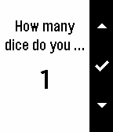
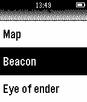

<!-- Generated by scripts/update_app_directory.py: do not edit by hand -->
[← All Pebble Developers](../developers.md)

# Frosted Torus

*3 apps · Last updated 2026-10-11 · [About these lists](../about-app-lists.md)*

Links: [Pebble App Store](https://apps.repebble.com/apps/dev/frosted-torus_55cf6edfdd278cc045000026) · [GitHub (Frosted-Torus)](https://github.com/Frosted-Torus) · [GitHub (KennethSchlatter)](https://github.com/KennethSchlatter)

<button type="button" data-filter="all" aria-pressed="true">All 3</button><button type="button" data-filter="watchface" aria-pressed="false" disabled>Watchfaces 0</button><button type="button" data-filter="watchapp" aria-pressed="false">Apps 3</button>

<label class="dev-sort">Sort by <select><option value="updated">Recently updated</option><option value="released">Newest release</option><option value="title">A–Z</option></select></label>

<h2 class="app-name" id="app-579a7a3322f599f144000208"><a href="https://apps.repebble.com/579a7a3322f599f144000208">Chuck Norris Jokes</a> v1.0</h2>
<a class="app-source" href="https://github.com/KennethSchlatter/ChuckJokes" title="Source code" data-search-exclude>View source</a>

App

No licence Released 2016-07-28 Updated 2016-07-28

Runs on: Round 2, Time 2, Pebble 2 Duo, Pebble 2, Time Round, Time, Classic

A watchapp that loads random Chuck Norris jokes from chucknorris.io.

<h2 class="app-name" id="app-5678b7d3bdb5f06f4b00007d"><a href="https://apps.repebble.com/5678b7d3bdb5f06f4b00007d">Shake2Roll</a> v1.5</h2>
<a class="app-source" href="https://www.github.com/Frosted-Torus/Shake2Roll" title="Source code" data-search-exclude>View source</a>

App

Released 2015-12-22 Updated 2016-07-25

Runs on: Round 2, Time 2, Pebble 2 Duo, Pebble 2, Time Round, Time, Classic

Are you frustrated with game dice? Shake2Roll is for you! Whether you&#x27;re playing Yahtzee or Dungeons &amp; Dragons or exploring probability in a math class, you can use this app. Press the middle…

<h2 class="app-name" id="app-55cf773067907b4aa200002a"><a href="https://apps.repebble.com/55cf773067907b4aa200002a">WatchCraft</a> v1.6</h2>
<a class="app-source" href="https://github.com/Frosted-Torus/WatchCraft" title="Source code" data-search-exclude>View source</a>

App

No licence Released 2015-08-15 Updated 2015-12-22

Runs on: Time 2, Pebble 2 Duo, Pebble 2, Time, Classic

Get Minecraft crafting recipes on your watch! The menus make it simple to find recipes. The key makes it easy to understand the recipes. This is still buggy and not as pretty as it could be. If…

